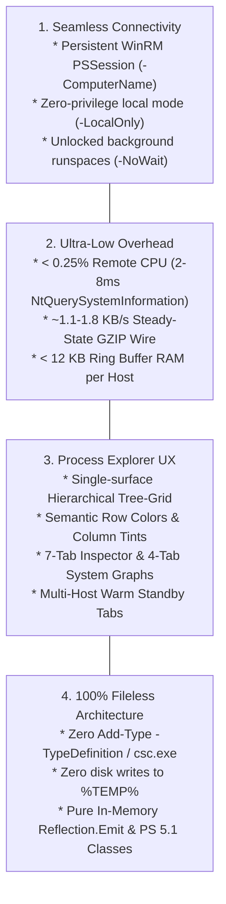

# PRODUCT.md -- PSRPM (PowerShell Remote Process Manager)

## 1. Executive Summary & Vision
**PSRPM (PowerShell Remote Process Manager)** is an enterprise-grade, **100% fileless**, agentless Windows process monitoring, forensics, and administration application. Built natively for **Windows PowerShell 5.1** and **PowerShell 7+** using pure WPF and in-memory `.NET Reflection.Emit`, PSRPM bridges the gap between raw remote command-line tools and native desktop inspection utilities.

Inspired by **Sysinternals Process Explorer**, PSRPM provides a unified hierarchical **Tree-Grid**, semantic row coloring, real-time telemetry sparklines, an interactive **Multi-Host Tabbed Session Bar**, a live **4-tab System Information** modal, a **7-tab Deep Process Properties Inspector**, and a live **Audit & Network Telemetry Console**--delivered entirely over persistent WinRM `PSSession`s (`-ComputerName`) or zero-privilege local execution (`-LocalOnly`).

---

## 2. Core Problem Statement

Traditional remote administration on Windows forced operators into severe trade-offs:
1. **WMI & CIM RPC Storms**: Calling `Get-CimInstance Win32_Process` or `Invoke-CimMethod -MethodName GetOwner` triggers `WmiPrvSE.exe` spikes of 12%-25% remote CPU, N+1 DCOM RPC round-trips, and massive network wire bloat (~280-450 KB/s).
2. **UI Freezes on Hung Apps**: `.NET`'s `System.Diagnostics.Process` invokes `user32!SendMessageTimeout` with a 5,000 ms timeout per window whenever `$p.Responding` is queried, freezing the UI whenever any remote window is unresponsive.
3. **EDR Trigger Risks**: Dropping temporary binaries or compiling C# on-the-fly (`Add-Type -TypeDefinition`) invokes `csc.exe` on disk, creating temporary `.cs`/`.dll` artifacts in `%TEMP%` that trip enterprise EDR/SIEM behavioral heuristics.
4. **Lack of Visual Diagnostics over Remoting**: System administrators troubleshooting remote endpoints had to reconstruct parent-child relationships, CPU utilization trends, and handle locks by piecing together multiple CLI cmdlets.

**PSRPM solves all four problems simultaneously** with single-call kernel collection (`NtQuerySystemInformation`), a differential GZIP wire protocol, 100% in-memory reflection, and an ergonomic Process Explorer-style interface.

---

## 3. Target Operator Personas

| Persona | Primary Workflow | Key PSRPM Capabilities Leveraged |
| :--- | :--- | :--- |
| **Windows Systems & Domain Admins** | Multi-server triage, hung service diagnostics, runaway resource troubleshooting. | Multi-Host Tabbed Session Bar, Service Process mapping, Windows Service control (Start/Stop/Restart), CPU Priority adjustment. |
| **Incident Responders & Threat Hunters** | Live incident response, anomalous process tree detection, unauthorized persistence verification. | Parent-child Tree-Grid, Authenticode signature verification, PEB CurrentDirectory/Environment inspection, TCP/IP socket tables, Two-Phase Atomic `KillTree`. |
| **Desktop Support & Fleet Engineers** | End-user workstation troubleshooting without interrupting user sessions or screen sharing. | WinRM remoting (`-ComputerName`), `-LocalOnly` zero-privilege mode, `-NoWait` background terminal execution, Packaged/WebView2 semantic grouping. |
| **DevOps & Windows SREs** | Diagnosing production microservices, CI/CD runner bottlenecks, memory leakage verification. | 4-Tab System Information graphs, 120-sample circular ring buffers, GZIP wire telemetry monitoring, CSV/JSON forensic snapshots. |

---

## 4. Architectural Pillars & Performance Budgets

Every capability in PSRPM is governed by four strict architectural non-negotiables:



1. **Near-Zero Remote Impact (`< 0.25%` CPU)**:
   - Collection runs in **2-8 ms** using a single native kernel transition (`ntdll!NtQuerySystemInformation(5)`).
   - Reusable unmanaged heap buffers (`[Marshal]::AllocHGlobal(512KB)`) prevent Large Object Heap (LOH) allocation churn.
2. **Differential Wire Compression (`~1.1 - 1.8 KB/s`)**:
   - Static metadata (`Path`, `CommandLine`, `User`, `Description`, `Company`, `Architecture`) is sent **only once** upon process spawn.
   - Subsequent ticks transmit only 7-element numeric delta tuples for processes whose metrics changed, compressed in-memory with GZIP.
3. **Zero-Leak Memory Architecture (`< 12 KB` RAM per Session)**:
   - Historical metrics use fixed-capacity circular `Queue[double]` ring buffers (30 samples for sparklines, 120 samples for System Information).
   - Dead processes are evicted synchronously from tracking hashtables on every tick.
   - Closed modals generate zero background string or geometry allocations.
4. **100% Fileless In-Memory Architecture**:
   - Zero temporary `.cs` or `.dll` files on disk; zero `csc.exe` invocations.
   - All P/Invoke bindings are created via `.NET Reflection.Emit` (`AssemblyBuilderAccess.Run`).
   - *EDR Transparency Notice*: In-memory Win32 and NTAPI operations remain fully visible and observable to endpoint sensors (ETW, Sysmon, EDR).

### 4.1 Security & Least Privilege Access Model (RBAC)

| Tier | Required Permissions | Supported Capabilities | Access Control Behavior |
| :--- | :--- | :--- | :--- |
| **Tier 1: Read-Only Monitoring** | Standard User member of `Remote Management Users` (No Local Administrator required) | Real-time CPU, RAM, Disk I/O & IOPS, network telemetry, hierarchical process tree, running services, loaded DLLs for owned processes | Non-owned processes report sanitized `[Access Denied / Protected]` command lines, environment blocks, and handles without throwing exceptions or hanging. |
| **Tier 2: Administrative Operations** | Local Administrator or `SeDebugPrivilege` enabled | Process termination (`KillProcess`, `KillTree`), process suspension/resumption, priority adjustment, kernel handle closure (`CloseHandle`), and secure memory dump generation (`CreateDump`) | Mutating actions validate live target identity (`PID`, `CreationTime`, and `ImageName`) before executing to prevent PID-reuse collateral damage. Memory dumps are written with non-inherited ACLs (`SYSTEM`, `Administrators`, and invoking user only). |

---

## 5. Core Capabilities & Feature Breakdown

### A. Sysinternals Process Explorer Unified Tree-Grid
- **Vector Parent-Child Hierarchy**: Pixel-snapped vector guide lines (`|`, `+-`, `\-`) and interactive expanders.
- **Smart Auto-Flat Sorting**: Clicking any column header (`CPU`, `Private Bytes`, `Working Set`, `PID`, `Handles`) automatically switches to **Flat View** for global system ranking; clicking **Tree** (`Ctrl+T`) restores the hierarchical tree.
- **Ancestor-Preserving Search Filter**: Typing in the search box (`Ctrl+F`) preserves full parent ancestry chains so matched processes retain operational context.
- **Semantic Category Highlighting**:
  - **Services** (`#FFE4E6` / `#3B1824`)
  - **Own / User Sessions** (`#E0E7FF` / `#1E2646`)
  - **Packaged / WebView2** (`#A5F3FC` / `#0E3A47`)
  - **Suspended** (`#CBD5E1` / `#334155`)
  - **New Process** (1-tick Lime Green flash)
  - **Exiting Process** (1-tick Crimson Red flash)

### B. Multi-Host Tabbed Session Bar
- **Concurrent Host Management**: Switch seamlessly between remote WinRM connections and local diagnostic sessions via header tabs (`+ Add Host` / `Ctrl+Shift+K`).
- **Warm Standby Pooling (0 KB/s Bandwidth, 0% CPU)**: Standby host sessions maintain open TCP sockets without executing collector code or polling.
- **Sub-5ms In-Place Tab Switching**: Preserves per-tab isolated caches (`ProcessMap`, `ServicesMap`, `SummaryVm`), delivering instant tab swaps with zero UI flicker.

### C. 7-Tab Deep Process Properties Inspector
- **Instant Core Mode (`< 20 ms`)**: Double-clicking any process immediately opens **Image** (Version, Linker Build Time, Path, Command Line, PEB WorkDir, Autostart, Authenticode signature validation), **Performance** counters, **TCP/IP** connections, hosted **Services**, and remote PEB **Environment** variables.
- **Lazy Tab-Activated `DLLs` & `Handles`**: Loaded modules (`EnumProcessModulesEx`) and open kernel handles (`NtQueryInformationProcess(51)`) load on-demand only when their specific tabs are selected.
- **Deadlock-Free Bulk Handle Scanning**: Skips synchronous `"File"` / named-pipe IRP queries, eliminating kernel hangs on Chromium Mojo pipes (`msedgewebview2.exe`).

### D. Live 4-Tab System Information Graphs (`Ctrl+I`)
- **Sysinternals System Information Replica**: Double-clicking any toolbar mini-graph opens a live 4-tab window:
  - **Summary**: Quad-card dashboard (CPU, System Commit, Physical Memory, I/O rates) with double-click tab jumping.
  - **CPU**: Total vs. Kernel CPU curves, context switch / interrupt / DPC deltas, and optional **Per-Core CPU Grid** (`Show one graph per CPU`).
  - **Memory**: Paging counters, Kernel Paged/Nonpaged pools, and exact Commit Charge limits.
  - **I/O**: Read vs. Write bandwidth and session I/O totals.
- **Zero Closed-Modal Overhead**: Vector geometry is evaluated only when the modal is open.

### E. Live Audit Trail & Network Telemetry Console (`Ctrl+L`)
- Real-time docked console displaying transport RTT, wire compression ratio, live bandwidth (`KB/s`), cumulative bytes received (`RX`), and differential delta counts.
- Streams live lifecycle events: `[SYNC]`, `[TELEM]`, `[PROC+]`, `[PROC-]`, `[INSPECT]`, and `[ACTION]`.
- Auto-capped rolling text buffer (max 24,000 characters) prevents terminal memory growth.

### F. Atomic Operations & Process Control
- **Two-Phase Atomic `KillTree`**: Suspends the entire tree top-down via `ntdll!NtSuspendProcess`, validates `CreationTime` against PID reuse, and terminates bottom-up.
- **Process Operations**: Suspend Process, Resume Process, Kill Process, and Priority Class adjustments (Idle, BelowNormal, Normal, AboveNormal, High).
- **Service Operations**: Start, Stop, and Restart hosted Windows Services.
- **Forensic Snapshots**: Export live process tables to structured CSV or JSON with timestamped filenames.

---

## 6. Execution Modes & Command Reference

### Standard Commands
```powershell
# 1. Primary WinRM Remote Connection
psrpm -ComputerName "SRV-PROD-01.corp.local"

# 2. Remote Connection with Explicit Credentials & Custom Port
$cred = Get-Credential
psrpm -ComputerName "10.20.30.40" -Credential $cred -Port 5986 -UseSSL

# 3. Zero-Privilege Local Execution (No WinRM or Admin required)
psrpm -LocalOnly

# 4. Asynchronous Background Execution (Terminal remains unlocked)
psrpm -LocalOnly -NoWait
psrpm -ComputerName "SRV-PROD-01" -NoWait
```

### Parameter Matrix
| Parameter | Type | Default | Description |
| :--- | :--- | :--- | :--- |
| `-ComputerName` | `String` | `"localhost"` | Hostname or IP address of remote Windows target. |
| `-Credential` | `PSCredential` | Current User | Credentials for authenticating remote WinRM session. |
| `-Port` | `Int32` | `5985` / `5986` | Custom WinRM port. |
| `-UseSSL` | `Switch` | `$false` | Enforce HTTPS encryption for WinRM remoting. |
| `-RefreshIntervalMs` | `Int32` | `1000` | Polling rate in milliseconds (`250` to `60000`). |
| `-LocalOnly` (`-Local`) | `Switch` | `$false` | Run directly in-process without WinRM remoting. |
| `-NoWait` (`-Background`) | `Switch` | `$false` | Launch asynchronously in background STA runspace, returning prompt immediately. |

---

## 7. Compliance & Enterprise Security Model

- **Zero-Footprint Policy**: Leaves no temporary files, DLLs, scheduled tasks, registry modifications, or services on the target.
- **Standard Enterprise Ports**: Communicates exclusively over standard WinRM ports (`5985` HTTP / `5986` HTTPS). No high-risk RPC/DCOM (135), SMB (445), or dynamic RPC ports required.
- **Credential Protection**: Credentials passed to `-Credential` or captured in modal dialogs remain strictly in-memory within the local PowerShell runspace and are never written to disk, event logs, or process argument lines.
- **Open Source Licensing**: Distributed under the permissive **MIT License**.
