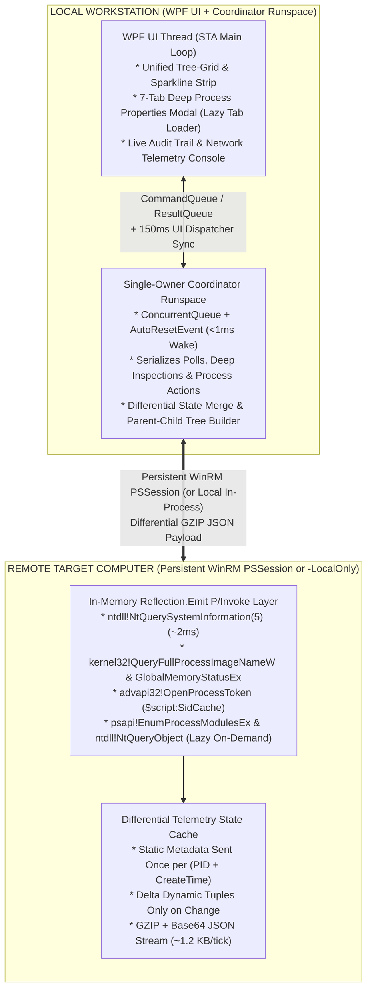

<p align="center">
  
</p>

# PSRPM -- PowerShell Remote Process Manager

[](CHANGELOG.md)
[](LICENSE)
[](PSRPM/PSRPM.psd1)

An enterprise-grade, ultra-low-overhead, **100% fileless** remote process monitoring and operations GUI built for Windows System Administrators, Desktop Engineers, and Security Analysts.

Inspired by **Sysinternals Process Explorer**, **PSRPM** delivers a unified hierarchical **Tree-Grid**, semantic process color coding, real-time telemetry sparklines, an interactive **Multi-Host Tabbed Session Bar**, a live **Audit Trail & Network Telemetry Console**, a **4-tab System Information** window, and a **7-tab Deep Process Properties Inspector** over persistent WinRM sessions (`-ComputerName`) or zero-privilege local execution (`-LocalOnly`).

---

## Table of Contents

- [Key Capabilities & Highlights](#key-capabilities--highlights)
- [Architectural Overview](#architectural-overview)
- [Performance & Network Benchmarks](#performance--network-benchmarks)
- [Zero-Leak Memory Architecture & Long-Running Stability](#zero-leak-memory-architecture--long-running-stability)
- [Getting Started & Installation](#getting-started--installation)
- [Usage Examples](#usage-examples)
- [Cmdlet & Parameter Reference](#cmdlet--parameter-reference)
- [Audit Trail & Network Telemetry Guide](#audit-trail--network-telemetry-guide)
- [Keyboard Shortcuts & Navigation](#keyboard-shortcuts--navigation)
- [Repository Structure & Documentation](#repository-structure--documentation)
- [License](#license)
- [Development Note](#development-note)

---

## Key Capabilities & Highlights

- **100% Fileless In-Memory Architecture (Zero Disk Binaries, Zero `csc.exe`)**:
  - Uses pure PowerShell 5.1 native classes ([`ViewModelClasses.ps1`](PSRPM/Private/ViewModelClasses.ps1)) and in-memory `.NET Reflection.Emit` (`AssemblyBuilderAccess.Run`) P/Invoke bindings.
  - **Zero `Add-Type -TypeDefinition`**, **zero `csc.exe` child processes**, and **zero temporary `.dll` or `.cs` files** written to disk or `%TEMP%`.
  - *EDR Visibility Notice*: In-memory Win32 and NTAPI operations remain fully visible and observable to endpoint telemetry sensors (ETW, Sysmon, and enterprise EDR).
- **Single-Call Native Kernel Telemetry (`< 2-5 ms` collection time)**:
  - Queries `ntdll.dll!NtQuerySystemInformation(SystemProcessInformation = 5)` and `kernel32.dll!GlobalMemoryStatusEx` into a persistent unmanaged buffer ([`DataCollector.ps1`](PSRPM/Private/DataCollector.ps1)).
  - Eliminates `WmiPrvSE.exe` CPU spikes, N+1 `Win32_Process.GetOwner()` RPC storms, `$p.Responding` 5-second UI hangs, and first-chance `AccessDenied` exception storms.
- **State-Aware Differential Wire Protocol (`~1.1 - 1.8 KB/s` steady state)**:
  - Transmits static metadata (`Path`, `CommandLine`, `User`, `Description`, `CompanyName`, `ParentPID`, `Arch`) **only once per process** upon spawn (keyed by `${PID}_${CreateTime}` to prevent PID-reuse collisions).
  - Subsequent ticks transmit only changed dynamic metric tuples (`[PID, CPU, WorkingSet, PrivateBytes, Threads, Handles, StatusFlags]`) compressed in-memory with GZIP.
- **Sysinternals Process Explorer Unified Tree-Grid**:
  - Single-surface hierarchical process tree with continuous pixel-snapped vector guide lines (`|`, `+-`, `\-`), interactive `[+]`/`[-]` expanders, `Left`/`Right` arrow key branch collapse/expansion, 16x16 process icons, right-aligned tabular numeric columns, and classic column tints (`CPU`, `Private Bytes`, `Working Set`).
  - **Smart Auto-Flat Sorting**: Clicking any column header (`CPU`, `Private Bytes`, `Working Set`, `PID`, `Name`, `Handles`) automatically switches to **Flat View** so processes rank globally across the entire system; clicking **Tree** (`Ctrl+T`) restores the hierarchical parent-child tree.
  - **Ancestor-Preserving Live Filter**: Typing in the filter box (`Ctrl+F`) or clicking a semantic category pill (`Services`, `Own / User`, `Packaged / WebView`) preserves parent ancestry chains in Tree View so every matching process remains contextualized.
- **Semantic Category Color Coding & Light/Dark Themes**:
  - Instant visual classification matching Process Explorer conventions: **Services** (Soft Rose), **Own / User Session** (Soft Indigo), **Packaged / WebView2** (Cyan), **Suspended** (Slate Grey), **New Process** (1-tick Lime Flash), and **Exiting Process** (1-tick Red Flash), with one-click switching between **Clean Light** and **Precision Dark** themes (`Ctrl+D`).
- **7-Tab Deep Process Properties Inspector with Lazy On-Demand Loading**:
  - **Instant Core Open (`< 20 ms`, `< 2 KB`)**: Opening Process Properties (`Double-Click` or `Enter`) queries only **Image** metadata (Version, PE Linker Build Timestamp, Path, Command Line, Remote PEB Current Directory, Autostart Location, On-Demand Authenticode Signature Verification), **Performance** counters & live ancestry tree, **TCP/IP** endpoints, hosted **Services**, and remote PEB **Environment** variables.
  - **Lazy Tab-Activated `DLLs` & `Handles`**: Loaded **DLLs** (`psapi!EnumProcessModulesEx`) and open kernel **Handles** (`ntdll!NtQueryInformationProcess(51)` + pipe-safe `NtQueryObject`) are queried **only when you click the `DLLs` or `Handles` tab**, ensuring zero unnecessary CPU or network load.
- **Sysinternals System Information Graphs (`Ctrl+I` or Double-Click Mini Graphs)**:
  - Double-clicking any toolbar mini-graph (`CPU`, `Commit`, `Phys RAM`) or pressing **`Ctrl+I`** opens a live 4-tab **System Information** window (`Summary`, `CPU`, `Memory`, `I/O`) with 4-minute (`240`-sample) circular ring buffers (`< 20 KB` total RAM), Kernel vs. Total CPU curves, per-CPU graph grid toggle (`Show one graph per CPU`), exact KB Commit/Physical/Kernel/Paging counters (`psapi!GetPerformanceInfo` + `NtQuerySystemInformation(2, 8)`), and zero UI rendering overhead while closed.
- **Multi-Host Tabbed Session Bar (Instant `< 5 ms` Switching, `0 KB/s` Standby)**:
  - Keep multiple remote targets (`-ComputerName` via WinRM) and local systems (`-LocalOnly`) open concurrently in header tabs (`Ctrl+Shift+K` or `[+] Add Host`).
  - Standby host sessions pause background polling entirely, consuming **0 KB/s wire bandwidth** and **0% remote CPU** while keeping persistent WinRM sessions warm and authenticated.
  - Each host tab preserves isolated in-memory caches (`ProcessMap`, `ServicesMap`, `SummaryVm`, `TelemStats`) enabling zero-flicker, sub-5 millisecond instant tab cycling (`Ctrl+Tab`, `Ctrl+Shift+Tab`, `Ctrl+W`).
- **Live Audit Trail & Network Telemetry Console (`Ctrl+L`)**:
  - Real-time header badges tracking transport RTT, GZIP wire compression ratio, live network bandwidth (`KB/s`), cumulative bytes received (`RX`), and differential delta counts, plus a live stream of `[SYNC]`, `[TELEM]`, `[PROC+]`, `[PROC-]`, `[INSPECT]`, `[ACTION]`, and `[SERVICE]` events.
- **Thread-Safe Single-Owner Runspace Bus & Atomic Operations**:
  - Serializes all periodic telemetry polls, on-demand deep inspections, and process/service control actions through a single background coordinator runspace ([`RunspaceEngine.ps1`](PSRPM/Private/RunspaceEngine.ps1)) using `ConcurrentQueue` + `AutoResetEvent` (`< 1 ms` wake latency).
  - **Two-Phase Atomic Tree Termination (`KillTree`)**: Suspends the target process tree top-down via `ntdll!NtSuspendProcess`, validates `CreationTime` to prevent PID-reuse collateral damage, and terminates bottom-up ([`ProcessActions.ps1`](PSRPM/Private/ProcessActions.ps1)).

---

## Architectural Overview



---

## Performance & Network Benchmarks

| Metric / Capability | Naive PowerShell (`Get-Process`) | Legacy WMI (`Win32_Process`) | **PSRPM Differential Engine** |
| :--- | :--- | :--- | :--- |
| **Remote CPU Impact** | 8% - 15% spike | 12% - 25% (`WmiPrvSE.exe`) | **< 0.25% CPU** |
| **Kernel Collection Time (175 procs)** | ~350 ms | ~650 ms - 2,500 ms | **~2 - 8 ms** |
| **Initial Full Baseline (175 procs, 265 svcs)** | ~280 KB (CLIXML) | ~450 KB (CLIXML) | **~24 KB GZIP** (`121 KB` raw, **80% saved**) |
| **Steady-State Wire Payload (1s tick)** | ~280 KB/s | ~450 KB/s | **~1.1 - 1.5 KB/s (Delta GZIP)** |
| **UI Hang Risk (`$p.Responding`)** | High (5s SendMessageTimeout) | None | **Zero (Kernel WaitReason)** |
| **UI State Preservation** | Lost on refresh | Lost on refresh | **100% In-Place Reconciled** |

---

## Zero-Leak Memory Architecture & Long-Running Stability

PSRPM is engineered for continuous multi-hour and multi-day monitoring sessions across production fleets without memory bloat, LOH (Large Object Heap) fragmentation, or performance degradation. Both the remote monitored host and the local administrator client enforce strict, deterministic memory controls:

### Remote Target Host (Monitored Machine)
- **Reusable Unmanaged Kernel Buffers**: Pre-allocates fixed unmanaged heap memory once per session (`512 KB` for `NtQuerySystemInformation(5)` and `8 KB` for system metrics). Eliminates per-tick unmanaged buffer allocation/deallocation churn and LOH memory fragmentation.
- **Deterministic Dead-Process Eviction**: At the end of every tick, active kernel keys are reconciled. Terminated PIDs are immediately purged from `ProcCpuCache`, `ProcMetaCache`, `LastDynState`, and `ActivePidToKey`, ensuring remote hashtables never leak or grow as processes spawn and exit over days of uptime.
- **Static Metadata Suppression**: Static attributes (executable path, command line, description, company, architecture) are transmitted across the wire **exactly once** per process lifetime. Once acknowledged in `$script:SentMetaKeys`, static metadata is suppressed from subsequent payloads, keeping steady-state wire traffic at ~1.1 - 1.5 KB/s.
- **0.00% CPU & 0 KB/s in Standby**: Inactive host tabs are completely excluded from the polling loop. Remote machines consume zero CPU and generate zero network traffic while their tab is not actively viewed.

### Local Administrator Client (WPF & Runspace)
- **Fixed-Capacity Circular Ring Buffers**: Historical metrics (CPU, Kernel, Commit, RAM, I/O rates, per-core metrics) use fixed-size `Queue[double]` ring buffers: **30 samples** for toolbar sparklines and **240 samples** (4 minutes) for System Information graphs. Historical telemetry memory is **hard-capped at < 20 KB per host session**.
- **Lazy Graph Execution**: Complex 360x120 vector path strings (`SysCpuPoints`, `SysCommitPoints`, per-core graphs) are calculated **only when the System Information window is open**. Closed modals generate zero background string allocations.
- **In-Place UI Diff Reconciliation**: Never calls `$ObservableCollection.Clear()`. Existing `ProcessItemViewModel` instances are updated in-place via dirty-checked `INotifyPropertyChanged`, avoiding visual tree churn and WPF Garbage Collection Gen 2 pauses.
- **Two-Stage Dead-Process Reaping**: Exited processes flash red for 1 tick, then are immediately purged from `ProcessMap` and the UI `ObservableCollection`, allowing the .NET runtime to reclaim memory immediately.
- **Rolling Activity Log Buffer**: The live Audit Console text buffer is auto-trimmed when it exceeds 24,000 characters (discarding the oldest 8,000 characters), preventing memory growth during heavy telemetry streaming.
- **Frozen Brushes & Icons**: All vector geometry, theme brushes, and extracted process icons call `.Freeze()`, detaching from WPF change-listening dependency graphs to prevent visual tree memory leaks.

---

## Getting Started & Installation

### Prerequisites
- **Local Workstation**: Windows 10, Windows 11, or Windows Server 2016+ with Windows PowerShell 5.1 (or PowerShell 7+ via Windows PowerShell compatibility).
- **Remote Target (`-ComputerName`)**: PowerShell Remoting / WinRM enabled (`Enable-PSRemoting -Force`). No files or agents are installed on the remote computer.

### Option 1: Import Directly from Repository
```powershell
Import-Module .\PSRPM\PSRPM.psd1 -Force
```

### Option 2: Install to Your User PowerShell Module Path
To make `Start-PSRPM` and the `psrpm` alias available automatically in every PowerShell window:
```powershell
$userModuleDir = Join-Path ([Environment]::GetFolderPath('MyDocuments')) 'WindowsPowerShell\Modules\PSRPM'
Copy-Item -Path .\PSRPM -Destination $userModuleDir -Recurse -Force
```

---

## Usage Examples

### 1. Connect to a Remote Computer (`-ComputerName`) -- Primary Mode
```powershell
# Connect to a remote computer using your current Windows session credentials
Start-PSRPM -ComputerName "SRV-PROD-01.corp.local"

# Or use the exported module alias 'psrpm' with explicit credentials
$cred = Get-Credential
psrpm -ComputerName "10.20.30.45" -Credential $cred -RefreshIntervalMs 1000

# Connect over HTTPS (WinRM SSL) on a custom port
Start-PSRPM -ComputerName "DMZ-WEB-01" -UseSSL -Port 5986 -Credential $cred
```

### 2. Run Locally Without WinRM or Admin Rights (`-LocalOnly`)
Ideal for local workstation diagnostics or testing under a non-administrator account without WinRM rights:
```powershell
Start-PSRPM -LocalOnly
# Or via alias:
psrpm -Local
```

### 3. Run in Background Without Locking the Terminal (`-NoWait`)
Launch PSRPM asynchronously so your terminal prompt returns **immediately (0 ms)**:
```powershell
# Launch in background on local computer
psrpm -LocalOnly -NoWait

# Launch in background targeting a remote host
psrpm -ComputerName "SRV-PROD-01" -NoWait
```
> **Tip for fully detached sessions**: If you want PSRPM to stay open even after you close the terminal window entirely, launch it detached via:
> ```powershell
> Start-Process powershell -WindowStyle Hidden -ArgumentList "-NoProfile -ExecutionPolicy Bypass -Command psrpm -LocalOnly"
> ```

### 4. Custom Application Icon Support (`-IconPath`)
PSRPM includes a built-in high-DPI telemetry icon (`Assets/psrpm.ico`) rendered across the title bar, taskbar, and all modal windows. You can also supply your own custom `.ico` or `.png` icon:
```powershell
# Launch with a custom enterprise or security operations icon
psrpm -LocalOnly -IconPath "C:\Icons\MyCustomIcon.ico"
```

---

## Cmdlet & Parameter Reference

### `Start-PSRPM` (Aliases: `psrpm`, `Start-RemoteProcessManager`)

```powershell
Start-PSRPM [[-ComputerName] <String>] [-Credential <PSCredential>] [-Port <Int32>] [-UseSSL] [-RefreshIntervalMs <Int32>] [-LocalOnly] [-NoWait] [-IconPath <String>] [<CommonParameters>]
```

| Parameter | Type | Required | Default | Description |
| :--- | :--- | :--- | :--- | :--- |
| `-ComputerName` | `String` | No | `"localhost"` | Hostname or IP address of the remote target Windows computer. |
| `-Credential` | `PSCredential` | No | Current User | Optional `PSCredential` for authenticating the WinRM `PSSession`. |
| `-Port` | `Int32` | No | `5985` / `5986` | Optional custom WinRM port. |
| `-UseSSL` | `SwitchParameter` | No | `$false` | Use HTTPS transport for the WinRM `PSSession`. |
| `-RefreshIntervalMs` | `Int32` | No | `1000` | Telemetry polling interval in milliseconds (`250` to `60000`). |
| `-LocalOnly` (`-Local`) | `SwitchParameter` | No | `$false` | Run directly in the local PowerShell process without WinRM or elevation requirements. |
| `-NoWait` (`-Background`) | `SwitchParameter` | No | `$false` | Launch asynchronously in a background STA runspace, returning terminal control immediately. |
| `-IconPath` | `String` | No | `Assets/psrpm.ico` | Path to a custom `.ico` or `.png` application icon for the title bar, taskbar, and all modals. |

---

## Audit Trail & Network Telemetry Guide

Press **`Ctrl+L`** (or click **Audit Console (Ctrl+L)** in the bottom-right status bar) to open the real-time **Audit Trail & Network Telemetry Console**.

### Sample Telemetry Output
```text
[12:55:58.219] [INIT] PSRPM initialized for target 'localhost' (Mode: WinRM PSSession, Interval: 1000ms).
[12:55:59.951] [SYNC #1] Full Snapshot from 'localhost' (WINRM) | RTT: 1173ms | Wire: 24.74 KB -> Raw: 121.06 KB (GZIP 80% saved) | Procs: 173, Services: 265
[12:56:25.850] [TELEM]   Seq #  26 | RTT:  58ms (Avg: 83.7ms) | Wire:  1.15 KB -> Raw:  1.74 KB (GZIP 34%) | BW: 1.15 KB/s (RX: 51.9 KB) | Dyn: 47, +Meta: 0, -Exit: 0
[12:56:28.997] [TELEM]   Seq #  29 | RTT: 145ms (Avg: 83.7ms) | Wire:  8.57 KB -> Raw: 31.01 KB (GZIP 72%) | BW: 8.57 KB/s (RX: 63.0 KB) | Dyn: 57, +Meta: 0, -Exit: 0, SvcSync: 265
[12:56:44.669] [TELEM]   Seq #  44 | RTT:  35ms (Avg: 67.6ms) | Wire:  2.17 KB -> Raw:  3.16 KB (GZIP 31%) | BW: 2.17 KB/s (RX: 82.7 KB) | Dyn: 78, +Meta: 1, -Exit: 0
[12:56:44.669] [PROC+]   Spawned: svchost.exe (PID 5748, PPID 908, User: NT AUTHORITY\SYSTEM)
```

### Telemetry Field Reference

| Tag / Field | Description |
| :--- | :--- |
| **`[SYNC #1]`** | Initial full baseline snapshot. Transmits static metadata for all running processes (`Procs: 173`) and services (`Services: 265`). Subsequent ticks never re-transmit static metadata for existing processes. |
| **`[TELEM]`** | Per-tick differential telemetry update (can be muted/resumed anytime via the **`Stream Ticks`** checkbox in the console header). |
| **`[PROC+]` / `[PROC-]`** | Real-time process creation (`Spawned`) and termination (`Exited`) events detected between ticks. |
| **`[INSPECT]`** | On-demand Process Properties inspection telemetry (`Mode: Core`, `Mode: DLLs`, or `Mode: Handles`) with RTT and payload size. |
| **`RTT (Avg)`** | Round-trip execution time in milliseconds for the poll (`Avg` is the rolling session average). |
| **`Wire -> Raw (GZIP %)`** | **`Wire`** is the compressed payload transferred over the network; **`Raw`** is the uncompressed JSON size; **`GZIP %`** is the bandwidth saved. |
| **`BW (RX)`** | **`BW`** is current network throughput (`KB/s`); **`RX`** is cumulative network kilobytes received during the session. |
| **`Dyn` / `+Meta` / `-Exit`** | **`Dyn`**: processes whose CPU/Memory/Handles changed on this tick; **`+Meta`**: newly spawned processes; **`-Exit`**: terminated processes. |
| **`SvcSync`** | Periodic 30-second refresh of the Windows Services table (`265` services). |

---

## Keyboard Shortcuts & Navigation

| Shortcut | Action |
| :--- | :--- |
| `Left Arrow` | Collapse selected process branch in Tree View (or jump to parent process if already collapsed/leaf) |
| `Right Arrow` | Expand selected process branch in Tree View (or jump to first child process if already expanded) |
| `Enter` / `Double-Click` | Open **7-Tab Process Properties Inspector** for selected process |
| `F5` | Immediate telemetry poll / refresh |
| `Space` | Pause / Resume live telemetry polling |
| `Ctrl+F` | Focus instant search filter box |
| `Esc` | Clear search filter and return focus to process grid |
| `Ctrl+T` | Toggle between **Hierarchical Tree-Grid** and **Flat List** (resets column sort to tree order) |
| `Ctrl+D` | Toggle between **Clean Light Theme** and **Precision Dark Theme** |
| `Ctrl+K` | Open **Connect to Target System** modal (switch active host) |
| `Ctrl+Shift+K` | Open **Connect to Target System** modal in **New Tab** mode |
| `Ctrl+W` | Close active Host Tab (switches to nearest remaining tab) |
| `Ctrl+Tab` / `Ctrl+Shift+Tab` | Cycle forward / backward through open Host Tabs |
| `Ctrl+I` / `Double-Click Mini Graph` | Open **System Information** window (`Summary`, `CPU`, `Memory`, `I/O` live graphs) |
| `Ctrl+L` | Toggle bottom **Audit Trail & Network Telemetry Console** |
| `Ctrl+S` | Export live process snapshot to CSV |
| `F1` | Open **Help, Keyboard Shortcuts & Information Reference** modal |
| `Del` | Terminate selected process (`KillProcess`) |
| `Shift+Del` | Terminate selected process and all descendants (`KillTree`) |

---

## Repository Structure & Documentation

```text
PSRPM/
+-- README.md                              # Project Overview, Benchmarks & Quickstart
+-- CHANGELOG.md                           # Version History & Release Notes
+-- LICENSE                                # MIT Open Source License
+-- AGENTS.md                              # Quick Guardrails for AI Coding Agents & Contributors
+-- PRODUCT.md                             # Comprehensive Product Strategy & Operator Personas
+-- DESIGN.md                              # Impeccable UI/UX Design System & Color Tokens
+-- docs/
|   +-- ENGINEERING_PLAYBOOK.md            # Mission, Guardrails, "Never-To-Do's" & Roadmap
|   +-- TELEMETRY_AND_PROTOCOL.md          # Deep-Dive into Differential Wire Protocol & Native P/Invoke
|   \-- USER_GUIDE.md                      # Operator Manual, 7-Tab Inspector & WinRM Troubleshooting
+-- PSRPM/                                 # PowerShell Module Directory
|   +-- PSRPM.psd1                         # PowerShell Module Manifest
|   +-- PSRPM.psm1                         # Main Module Entry Point & WPF Controller
|   +-- Private/
|   |   +-- DataCollector.ps1              # Reflection.Emit Native Collector & Delta Engine
|   |   +-- DeepInspector.ps1              # Lazy On-Demand PEB, DLLs, Handles & Socket Inspector
|   |   +-- ProcessActions.ps1             # Atomic KillTree, Suspend/Resume, Priority & Service Control
|   |   +-- RunspaceEngine.ps1             # Single-Owner Runspace Coordinator & Tree Reconciler
|   |   \-- ViewModelClasses.ps1           # Pure PS 5.1 INotifyPropertyChanged ViewModels
|   +-- Assets/
|   |   +-- psrpm.ico                      # Multi-Resolution Windows Icon (256, 48, 32, 24, 16)
|   |   +-- psrpm.png / psrpm.svg          # Master 256x256 High-DPI Tachometer Gauge & Turbo Impeller Assets
|   |   +-- psrpm_*.png                    # Mipmap PNGs (16x16, 24x24, 32x32, 48x48, 256x256)
|   |   \-- psrpm_*.svg                    # Scalable Vector SVGs (16x16, 24x24, 32x32, 48x48, 256x256)
|   \-- UI/
|       +-- MainWindow.xaml                # Process Explorer-Inspired Tree-Grid Main Window
|       +-- PropertiesWindow.xaml          # 7-Tab Process Properties Inspector Modal
|       +-- SystemInfoWindow.xaml          # 4-Tab Live System Information Graphs Modal
|       +-- ConnectDialog.xaml             # In-App Remote Host / LocalOnly Switcher Modal
|       \-- HelpWindow.xaml                # 4-Tab Help, Shortcuts & Runtime Diagnostics Modal
\-- Tests/
    \-- Test-PSRPMEngine.ps1               # Automated 11-Suite Verification & Benchmark Script
```

- **[Engineering Playbook: Mission, Guardrails, "Never-To-Do's" & Roadmap (`docs/ENGINEERING_PLAYBOOK.md`)](docs/ENGINEERING_PLAYBOOK.md)**
- **[Telemetry & Wire Protocol Architecture (`docs/TELEMETRY_AND_PROTOCOL.md`)](docs/TELEMETRY_AND_PROTOCOL.md)**
- **[Operator User Guide & Troubleshooting (`docs/USER_GUIDE.md`)](docs/USER_GUIDE.md)**
- **[Agent & Contributor Quick-Reference (`AGENTS.md`)](AGENTS.md)**
- **[Product Strategy & Specifications (`PRODUCT.md`)](PRODUCT.md)**
- **[Design System & Visual Specifications (`DESIGN.md`)](DESIGN.md)**
- **[Release Notes & Version History (`CHANGELOG.md`)](CHANGELOG.md)**
- **[License (`LICENSE`)](LICENSE)**

---

## Security & Least Privilege Access Model (RBAC)

PSRPM is designed with a strict two-tier privilege separation architecture:

| Tier | Required Permissions | Supported Capabilities | Access Control Behavior |
| :--- | :--- | :--- | :--- |
| **Tier 1: Read-Only Monitoring** | Standard User member of `Remote Management Users` (No Local Administrator required) | Real-time CPU, RAM, Disk I/O & IOPS, network telemetry, hierarchical process tree, running services, loaded DLLs for owned processes | Non-owned processes report sanitized `[Access Denied / Protected]` command lines, environment blocks, and handles without throwing exceptions or hanging. |
| **Tier 2: Administrative Operations** | Local Administrator or `SeDebugPrivilege` enabled | Process termination (`KillProcess`, `KillTree`), process suspension/resumption, priority adjustment, kernel handle closure (`CloseHandle`), and secure memory dump generation (`CreateDump`) | Mutating actions validate live target identity (`PID`, `CreationTime`, and `ImageName`) before executing to prevent PID-reuse collateral damage. Memory dumps are written with non-inherited ACLs (`SYSTEM`, `Administrators`, and invoking user only). |

---

## License

This project is licensed under the terms of the **MIT License**. See the [LICENSE](LICENSE) file for details.

---

## Development Note

This project was built from conception to production through human-directed **agentic AI coding** (pair programming with Google DeepMind Antigravity). All architectural guardrails, native `Reflection.Emit` kernel collectors, WinRM differential telemetry wire protocols, and WPF desktop interfaces were engineered, benchmarked, and verified under the strict fileless security and performance budgets documented in the [Engineering Playbook](docs/ENGINEERING_PLAYBOOK.md) and [AGENTS.md](AGENTS.md).

