# PSRPM — PowerShell Remote Process Manager

[](CHANGELOG.md)
[](PSRPM/PSRPM.psd1)
[](LICENSE)

**Sysinternals Process Explorer, TCPView-style socket inspection, and Services/Handle forensics over a single persistent WinRM `PSSession` — zero remote agents, zero temporary files on disk, and `< 0.25%` remote CPU.**

Built natively for Windows PowerShell 5.1 (`Desktop` edition) using WPF and pure in-memory `.NET Reflection.Emit`, PSRPM gives systems administrators, SREs, and incident responders high-density process diagnostics both locally (zero-argument default / `-LocalOnly`) and on remote servers (`-ComputerName`).

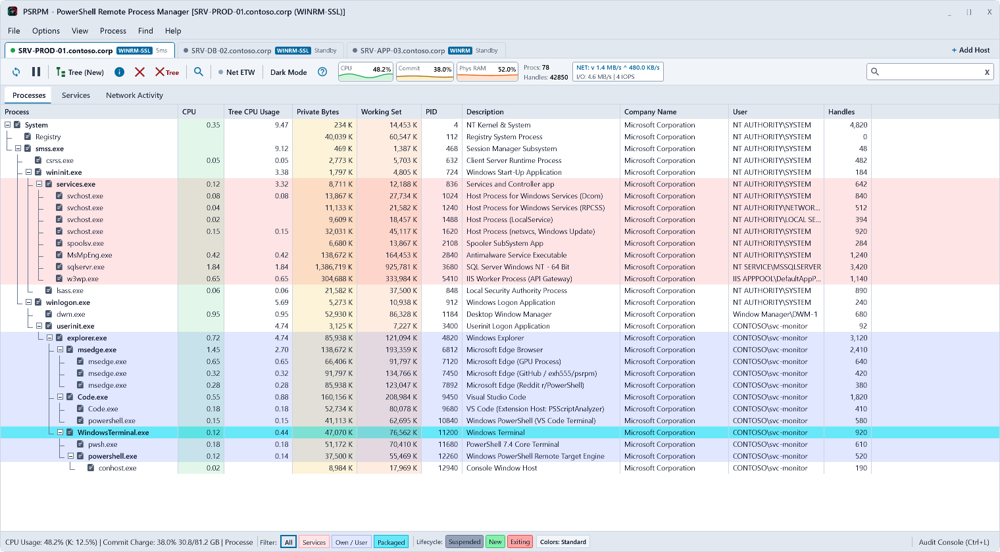
*Clean Light theme showing the vector Process Tree-Grid, Multi-Host Tabbed Session Bar, toolbar CPU/Commit/RAM sparklines, and live semantic status pills. See all captures in the **[Screenshot Tour](docs/screenshots/README.md)** (Dark, Tokyo Night, High-Contrast, Classic themes, and `Network Activity` use the same shared theme token engine).*

---

## 10-Second Quickstart

```powershell
git clone https://github.com/exh555/psrpm.git
cd psrpm
Import-Module .\PSRPM\PSRPM.psd1 -Force

# 1. Local execution (zero-argument default — non-blocking background STA launch, no WinRM/admin required)
Start-PSRPM

# 2. Remote monitoring over a persistent WinRM PSSession (alias: psrpm)
psrpm -ComputerName "SRV-PROD-01" -Credential (Get-Credential)

# 3. Launch in Tokyo Night theme and block the calling terminal until the window closes
psrpm -ComputerName "SRV-PROD-01" -Theme TokyoNight -Wait
```

> **Prerequisites**: Windows desktop session (WPF) running Windows PowerShell 5.1 (`Desktop` edition) -- targeted because PowerShell 5.1 is preinstalled and guaranteed on all Windows 10/11 and Windows Server endpoints with zero extra runtime deployment. Remote monitoring uses WinRM ports `5985` (HTTP) or `5986` (HTTPS).

---

## Why PSRPM?

Remote Windows diagnostics have historically forced engineers into an awkward compromise between heavy enterprise agents, noisy RPC polling, and disconnected CLI snippets:

- **Firewall & Change-Control Friction**: Copying Sysinternals executables over administrative SMB shares (`C$`) or opening legacy DCOM/RPC ports (`135` / `445`) often breaks segmentation rules, while installing monitoring agents isn't practical for ad-hoc incident triage. WinRM (`5985` / `5986`) is usually already enabled and audited.
- **WMI Observer Effect & Hung-Window Stalls**: Polling `Get-CimInstance Win32_Process` and `GetOwner()` sparks `WmiPrvSE.exe` CPU spikes (`12% - 25%`) and `~280 - 450 KB/s` wire chatter, while `.NET`'s `$proc.Responding` calls synchronous `user32!SendMessageTimeout` (`5,000 ms` per hung window).
- **Inline C# Compiler Noise**: Ad-hoc remoting scripts built on `Add-Type -TypeDefinition` launch `csc.exe` inside remote `wsmprovhost.exe` hosts, write temporary `.cs`/`.dll` files to `%TEMP%`, add cold-start latency, and trip compiler-from-WinRM detections.
- **Missing Real-Time Tree, Socket & Handle Context**: Reconstructing parent-child lineage, ephemeral worker spawns, handle/DLL locks, hosted `svchost.exe` services, and active TCP/UDP sockets across plain text tables slows down root-cause triage.

**PSRPM solves all four constraints at once** by executing `ntdll!NtQuerySystemInformation` and native IP Helper / ETW collectors entirely in memory via `.NET Reflection.Emit` over your existing WinRM session—delivering Process Explorer + TCPView workflows at **`< 0.25%` remote CPU** and **`~1.1 - 1.8 KB/s`** steady-state bandwidth.

| Metric / Capability | Standard Task Manager | PowerShell (`Get-CimInstance` / `.NET Process`) | Sysinternals over SMB / RPC | **PSRPM (`v1.18.0`)** |
| :--- | :--- | :--- | :--- | :--- |
| **Remote Collector Engine** | N/A (Local UI) | WMI / DCOM RPC (`WmiPrvSE.exe`) | Remote binary + service / RPC | **Single `ntdll!NtQuerySystemInformation(5)` syscall** |
| **Remote CPU Overhead** | N/A | `12% - 25%` RPC spikes | Low once running | **`< 0.25%` CPU (`2 - 8 ms` per tick)** |
| **Steady-State Wire Traffic** | N/A | `~280 - 450 KB/s` | Heavy RPC payloads | **`~1.1 - 1.8 KB/s` differential GZIP JSON** |
| **Remote Disk Footprint** | None | None | Drops service / agent binaries | **Zero remote installation; `0 csc.exe`, `0` temp `.dll`/`.cs`** |
| **Hung-Window UI Freeze Risk** | Occasional UI stall | `$p.Responding` blocks `5,000 ms` per window | Local | **Immune** (reads kernel `WaitReason` directly) |
| **Multi-Host Operations** | 1 machine per window | Scripted loops | Separate windows | **Single-window Host Tabs (`0 KB/s` idle standby)** |

---

## Core Capabilities

### 1. Process Explorer Tree-Grid, 31-Column Catalog & Baseline Diffs (`Ctrl+B`)
- **Pixel-Snapped Vector Hierarchy**: Parent-child tree connectors (`|`, `+-`, `\-`) and collapsible expanders rendered via WPF `<Path>` vectors across DPI scales. Clicking the `Process` column cycles 4 ways (`Tree Newest First` -> `Tree Classic Oldest First` -> `Flat Asc` -> `Flat Desc`); clicking metric headers switches to **Flat View** for global ranking (`Ctrl+T` returns to Tree View).
- **Ancestor-Preserving Live Filter (`Ctrl+F` / `Esc`)**: Filters processes instantly by name, PID, path, command line, user, or description while keeping parent ancestry chains visible for full context.
- **Process Explorer Semantic Coloring**: Color-codes **New** (1-tick green flash), **Exiting** (1-tick crimson flash), **Suspended**, **High CPU (`> 50%`)**, **Packaged / WebView2** (UWP, AppContainer, `msedgewebview2.exe`), **Service Process**, **Own / User**, and **System**. Category highlights can be toggled without disabling live spawn/exit flashes.
- **31-Column Customization & Persisted Preferences**: Open **Select Process Columns** to search, toggle, and reorder 31 columns across `Identity`, `Performance`, `Image`, and `Network ETW` groups, or apply one-click presets (`Default (10)`, `Process Explorer`, `Forensic / Security`). Explicit layout/theme preferences save cleanly to `%LOCALAPPDATA%\PSRPM\preferences.json`.
- **Process Baseline Snapshots (`Ctrl+B`)**: Captures `CPU`, `Private Bytes`, `Working Set`, and `Handles` with `PID` + `CreateTime` PID-reuse protection, surfacing `[NEW]` markers and signed `CPU Delta`, `Private Delta`, `WS Delta`, `Peak CPU`, and `Peak Private` columns.
- **Batch & Atomic Control**: `Ctrl+Click` / `Shift+Click` multi-select dispatch for **Suspend / Resume**, **Set Priority** (`Idle` through `High`), **Kill Process**, and **Two-Phase Atomic `KillTree`** (suspends parent-to-child via `ntdll!NtSuspendProcess`, re-validates `CreationTime` + `ImageName`, then terminates bottom-up). `PID <= 4` kernel processes are guarded against mutation.

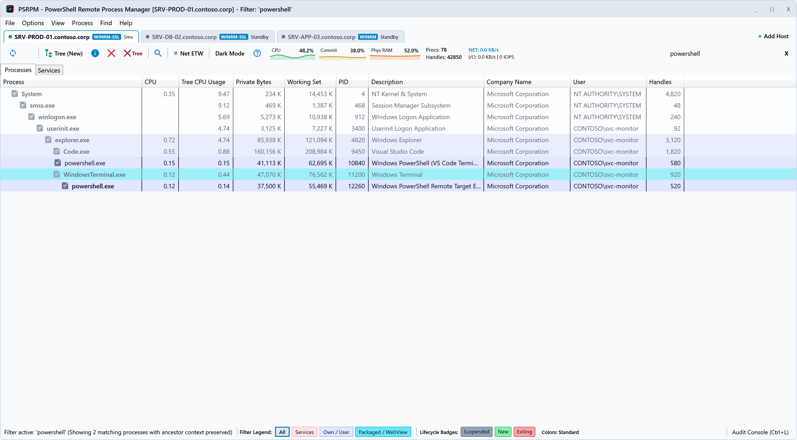

---

### 2. TCPView-Style Network Activity & Opt-In Kernel ETW (`Ctrl+Shift+N`)
PSRPM combines an on-demand TCPView-style socket viewer with an optional zero-cost-when-off kernel network ETW stream inside the **Network Activity** workspace tab:
- **Active Sockets (`AllSockets`)**: Queries host-wide IPv4 and IPv6 TCP/UDP endpoints via `iphlpapi!GetExtendedTcpTable` / `GetExtendedUdpTable` with `OWNER_MODULE` attribution and per-connection EStats (`GetPerTcpConnectionEStats` / `GetPerTcp6ConnectionEStats`) for `Sent/Recv Packets` and `Sent/Recv Bytes`. Includes quick filter chips (`TCP v4`, `TCP v6`, `UDP v4`, `UDP v6`, `Established`, `Listening`, `Syn Sent`, `Time/Close Wait`), bottom summary bar (`Endpoints | Established | Listening | Time Wait | Close Wait`), `Auto (2s)` refresh, CSV export, jump-to-tree / `Process Properties (TCP/IP)`, and **Close Conn** (`iphlpapi!SetTcpEntry` for IPv4 TCP, Administrator required).
- **Opt-In Per-Process Kernel Network ETW (`Ctrl+Shift+N`)**: Disabled by default (`0%` overhead when off). When enabled, a pure-IL (`Reflection.Emit`) ETW consumer attaches to classic `TcpIpGuid`/`UdpIpGuid` or `Microsoft-Windows-Kernel-Network`, maintains lock-free double-buffered slot recycling (`DrainAndReset`), enforces a `25k/50k` events/sec circuit breaker, populates 4 process-grid columns (`Network`, `Tree Net`, `Net Recv`, `Net Send`) with 3-tier subtree rollup, and streams `Recv`/`Send` bursts into **ETW Activity Stream** (buffering up to `2,000` off-tab events in `PendingNetTimeline`). Non-admin Tier-1 sessions degrade gracefully with a non-blocking banner.

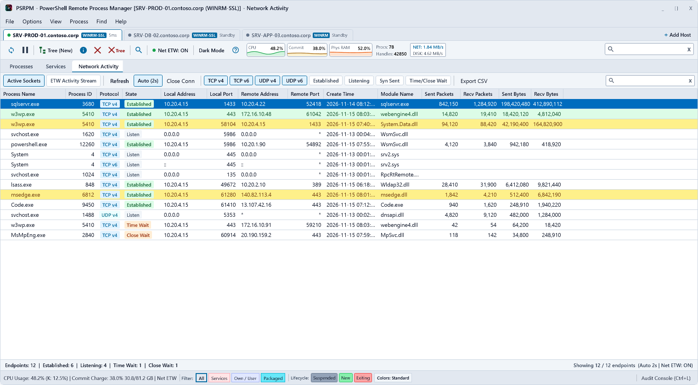

---

### 3. Deep Process, Handle & Windows Service Forensics
- **7-Tab Process Properties Inspector (`Enter` / Double-Click)**:
  - **Instant Core Mode (`~12 - 25 ms`, `~1.5 - 2.5 KB`)**: Opens immediately with **Image** (PE Linker Build Timestamp, File Version, Path, Command Line, remote PEB `CurrentDirectory`, Autostart location, on-demand Authenticode **Verify**), **Performance** (CPU times, Cycles, Total/GDI/USER handles, Kernel pools, I/O counters, Process Ancestry Tree), **TCP/IP**, **Services**, and remote PEB **Environment** variables.
  - **Lazy Tab-Activated `DLLs` & `Handles`**: Enumerates loaded modules (`psapi!EnumProcessModulesEx`, cached by path, `~30 - 45 ms`) and kernel handles (`ntdll!NtQueryInformationProcess(51)`, `~20 - 35 ms`) only when you click their tabs.

| Image & Security Metadata | Performance & Ancestry Tree | Lazy-Loaded DLL Modules |
| :---: | :---: | :---: |
| 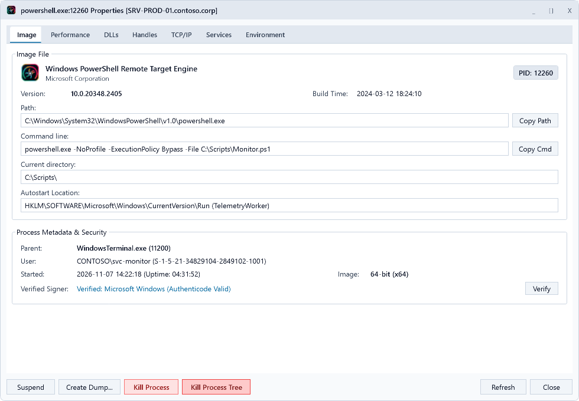 | 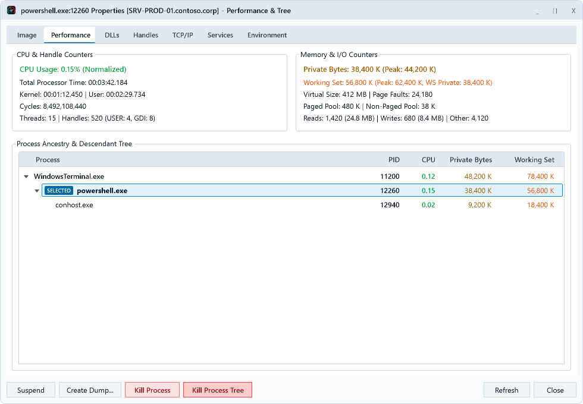 | 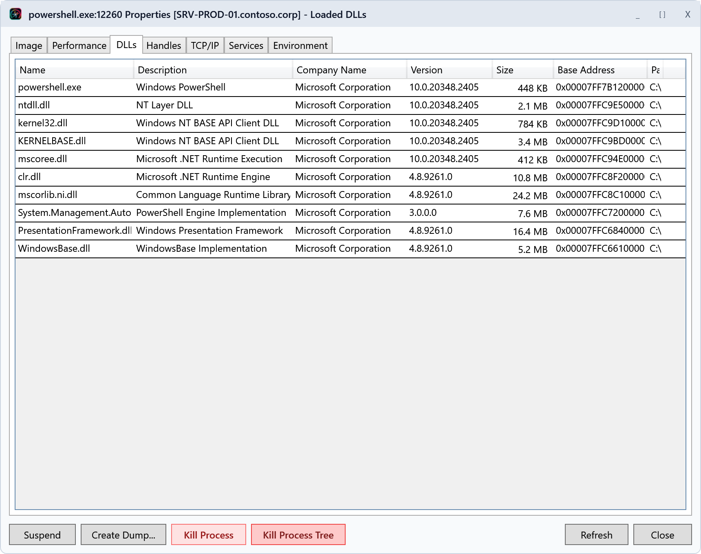 |

- **Deadlock-Free Global Handle / DLL Search (`Ctrl+Shift+F`)**: Searches loaded DLL paths and open kernel handles across processes. `"File"` handles are strictly gated with `GetFileType -eq 1` (`FILE_TYPE_DISK`) -> `GetFinalPathNameByHandleW`, resolving locked disk files and folders while never calling `NtQueryObject(ObjectNameInformation)` on synchronous named pipes (preventing kernel hangs on `msedgewebview2.exe` Mojo pipes). Supports individual `CloseHandle` via `DuplicateHandle`.
- **Services Manager & Two-Way Dependencies Inspector**: Manage Windows Services in the dedicated **Services** tab (`Start`, `Stop`, `Restart`, `Select Process in Tree`) and open **Properties & Dependencies** to trace both *Services this depends on* and *Services depending on this*.

| Services Manager | Service Details & Two-Way Dependencies |
| :---: | :---: |
| 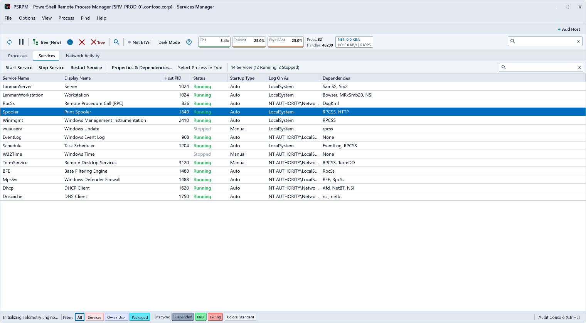 | 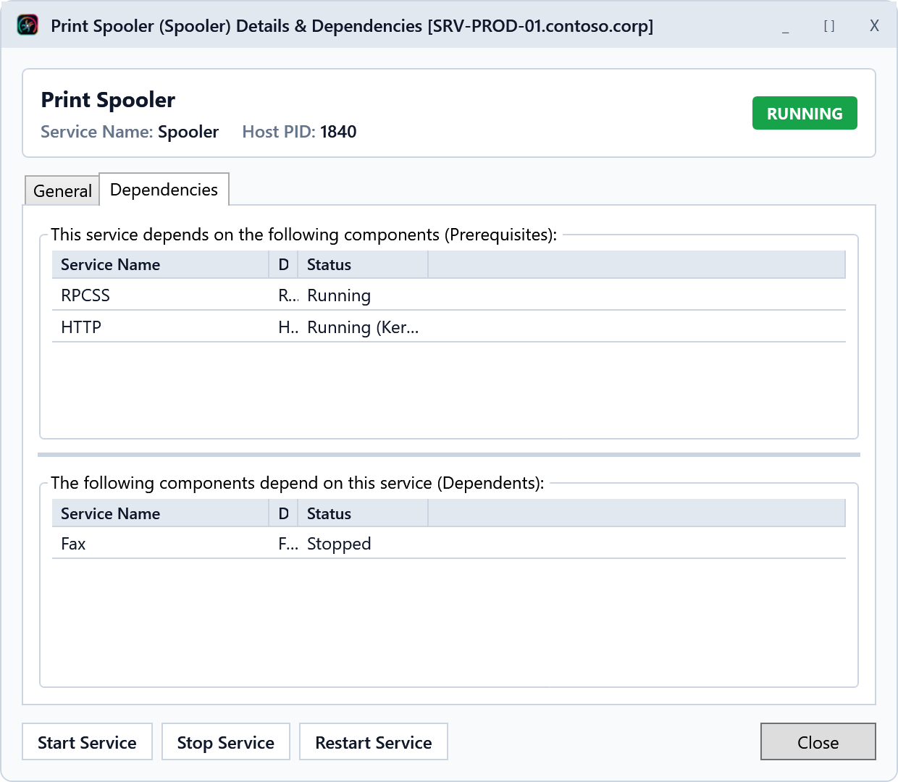 |

- **Restricted-ACL Remote Memory Dumps (`CreateDump`)**: Generates on-demand Minidumps and Full Memory Dumps in `%SystemRoot%\Temp\PSRPM_Dumps` (or `%LOCALAPPDATA%\PSRPM\Dumps`) with inheritance disabled and DACLs restricted strictly to `SYSTEM`, `Administrators`, and the invoking operator.

---

### 4. 5-Tab System Information (`Ctrl+I`), 6 Themes (`Ctrl+D`) & Multi-Host Tabs
- **Live 5-Tab System Information (`Ctrl+I` or Double-Click Mini-Graphs)**: Replicates Process Explorer's **Summary** (hardware/storage inventory + 2x2 graphs with double-click tab jump), **CPU** (Total vs. Kernel curves, Context Switch / Interrupt / System Call deltas, optional **Show one graph per CPU** per-core grid), **Memory** (Commit Charge, Physical RAM, Paged/Nonpaged Kernel Pools, Paging deltas), **I/O**, and **Network** (Rx/Tx curves, sockets, ETW burst stream) — with interactive crosshair hover tooltips showing timestamped top-process attribution across the 240-sample (4-minute) ring buffer.

| System Information Summary | System Information CPU & Kernel Telemetry |
| :---: | :---: |
| 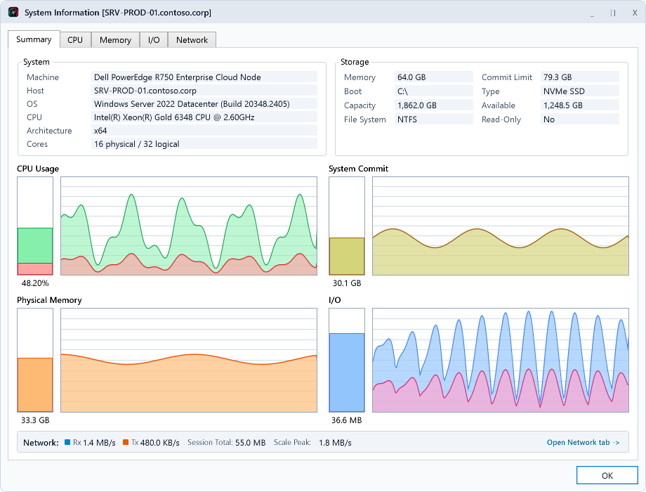 | 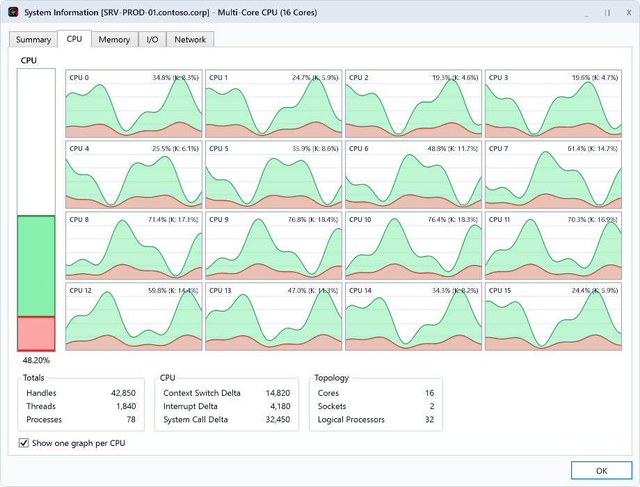 |

- **6 Synchronized Themes (`Ctrl+D` / `-Theme` / `Options -> Theme`)**: Switch live across **Clean Light**, **Precision Dark**, **Tokyo Night**, **Tokyo Night Light**, **Classic**, and **High-Contrast** powered by a centralized `PSRPMThemeRegistry` propagating `DynamicResource` tokens across the main window and all modals.
- **Multi-Host Tabbed Session Bar (`Ctrl+Shift+K`, `Ctrl+Tab`, `Ctrl+W`)**: Connect to multiple remote hosts and `-LocalOnly` in parallel tabs. Active tab switches swap isolated state caches in `< 5 ms`; standby host tabs pause polling to consume **`0 KB/s` network bandwidth and `0%` remote CPU** while keeping their WinRM socket warm.

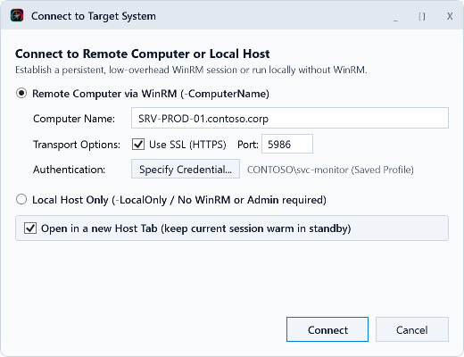

---

### 5. Audit & Network Telemetry Console (`Ctrl+L`) & Automated Verification
- **Live Audit & Telemetry Console (`Ctrl+L`)**: Docked, resizable monospace console streaming real-time transport RTT, payload GZIP compression ratio, wire throughput (`KB/s`), cumulative RX bytes, sequence delta counts, and structured lifecycle events (`[INIT]`, `[SYNC]`, `[TELEM]`, `[PROC+]`, `[PROC-]`, `[INSPECT]`, `[ACTION]`, `[SERVICE]`), backed by a rolling text buffer capped at `72,000` characters (trimming back to `48,000`).
- **Automated Quality & Regression Harness**: Continuously validated via [`Tests/Test-PSRPMEngine.ps1`](Tests/Test-PSRPMEngine.ps1) (12 core engine, fileless audit, delta benchmark, ETW, PID-reuse, fault-injection, and 6-theme parity suites), [`Tests/Test-PSRPMExtendedQA.ps1`](Tests/Test-PSRPMExtendedQA.ps1) (44/44 checks in [`Tests/QA_Report.md`](Tests/QA_Report.md)), and [`Tests/Test-ReleaseReadiness.ps1`](Tests/Test-ReleaseReadiness.ps1).

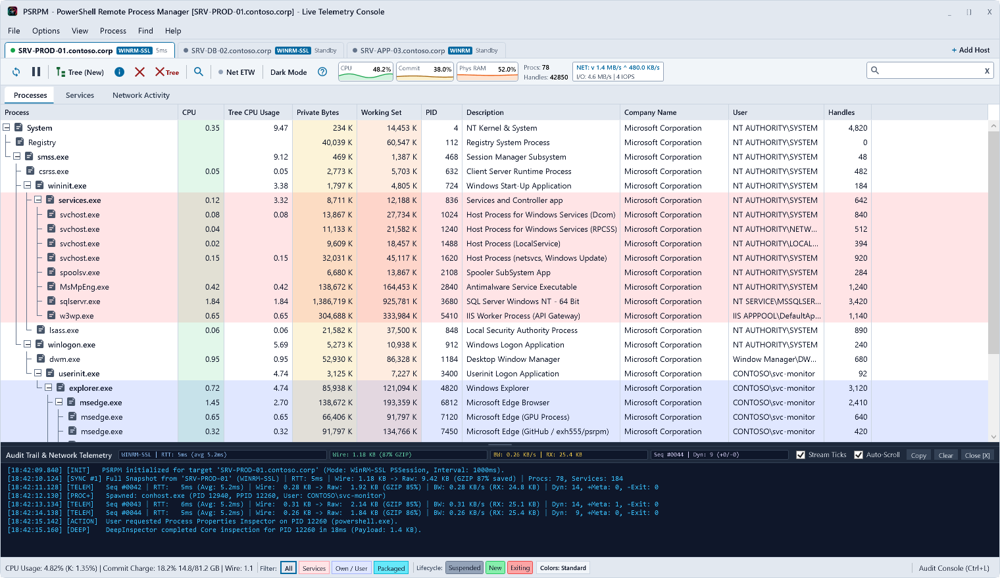

---

## Architecture & Engineering Invariants

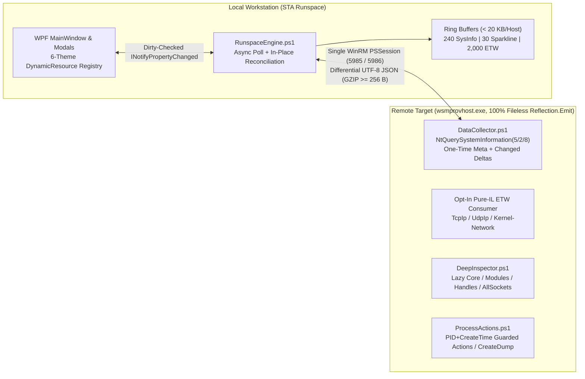

1. **Zero Per-Tick Unmanaged Heap Churn**: Pre-allocates reusable unmanaged buffers at session initialization (`512 KB` for Class 5 process enumeration, `256 KB` for service enumeration, and an `8 KB` scratch buffer scaling dynamically up to `CoreCount * 48` / `128 KB` max for Class 8) and resets pointers cleanly via `try/finally`.
2. **Synchronous Dead-Process Eviction & Smart Compression**: Terminated processes are pruned from remote collector caches every tick (`"dead":[...]`), static strings (`Path`, `CommandLine`, `Description`, `CompanyName`, `User`, `Architecture`) transmit once per spawn, and small deltas `< 256` bytes bypass GZIP to avoid compression-header bloat while larger payloads use in-memory `GZIP:` streaming.
3. **In-Place UI Reconciliation & Closed-Modal Silence**: Live `ObservableCollection` grids never call `.Clear()`; scroll offsets, selection sets, and tree expansion states persist cleanly across ticks, and System Information `<Path>` geometry is only generated while `$summaryVm.IsSysInfoOpen` is true.
4. **Hardened Against Real-World Windows Pitfalls**: Unsigned 32-bit kernel counters use `([long]ReadInt32 -band 0xFFFFFFFFL)` instead of `[uint32]` casts to prevent overflow crashes after high system uptime; `x86`/`x64` P/Invoke structures parameterize `[IntPtr]::Size`; all `.ps1`/`.psm1` files are strictly 7-bit ASCII for Windows PowerShell 5.1 Windows-1252 parser safety.

Deep technical specifications live in **[`docs/TELEMETRY_AND_PROTOCOL.md`](docs/TELEMETRY_AND_PROTOCOL.md)**, **[`DESIGN.md`](DESIGN.md)**, and **[`docs/ENGINEERING_PLAYBOOK.md`](docs/ENGINEERING_PLAYBOOK.md)**.

---

## Command Reference (`Start-PSRPM` / `Start-RemoteProcessManager` / `psrpm`)

```powershell
# Launch locally by default (zero WinRM or Admin prerequisites)
Start-PSRPM

# Monitor a remote server over HTTPS on port 5986 with alternate credentials
psrpm -ComputerName "10.20.30.40" -Credential (Get-Credential) -Port 5986 -UseSSL

# High-frequency local troubleshooting pinned on top of other windows
Start-PSRPM -LocalOnly -RefreshIntervalMs 500 -AlwaysOnTop -Theme Dark
```

| Parameter | Type | Default | Description |
| :--- | :--- | :--- | :--- |
| `-ComputerName` | `String` | Local Mode (or `"localhost"`) | Target hostname or IP address for WinRM remoting (positional `0`). Omitting `-ComputerName`/`-Credential`/`-Port`/`-UseSSL` runs in Local-Only Mode automatically. |
| `-Credential` | `PSCredential` | Current User | Alternate domain/local credentials for authenticating the `PSSession`. |
| `-Port` | `Int32` | `5985` / `5986` | Custom WinRM TCP port (`0` resolves default HTTP/HTTPS port). |
| `-UseSSL` | `Switch` | `$false` | Connect using HTTPS WinRM transport. |
| `-RefreshIntervalMs` | `Int32` | `1000` | Polling interval in milliseconds (`250` to `60000`). |
| `-LocalOnly` (`-Local`) | `Switch` | Auto when zero-arg | Force execution directly in the local PowerShell process without WinRM or admin rights. |
| `-Wait` | `Switch` | `$false` | Block the calling PowerShell terminal synchronously until the PSRPM window closes (default launches asynchronously in a background STA runspace). |
| `-NoWait` (`-Background`) | `Switch` | Legacy alias | Retained for backwards compatibility (background non-blocking launch is now active by default whenever `-Wait` is omitted). |
| `-Theme` | `String` | `"Light"` | Initial theme: `Light`, `Dark`, `TokyoNight`, `TokyoNightLight`, `Classic`, or `HighContrast`. |
| `-Dark` | `Switch` | `$false` | Shortcut switch to launch with the dark theme. |
| `-AlwaysOnTop` (`-Topmost`) | `Switch` | `$false` | Pin PSRPM above standard desktop windows. |
| `-IconPath` | `String` | Bundled Icon | Optional custom `.ico`/image path for window branding. |
| `-Defaults` (`-Default`, `-NoConfig`, `-NoPreferences`) | `Switch` | `$false` | Temporarily skip loading saved preferences from `%LOCALAPPDATA%\PSRPM\preferences.json` and start with built-in factory defaults (saved config on disk is left untouched). |

### Connecting to Workgroup / Non-Domain Hosts (`TrustedHosts`)
When targeting a non-domain machine or IP address over HTTP WinRM:
```powershell
# Run once in an elevated PowerShell console on your local workstation:
Set-Item WSMan:\localhost\Client\TrustedHosts -Value "10.20.30.45" -Concatenate -Force

# Connect with explicit credentials:
psrpm -ComputerName "10.20.30.45" -Credential (Get-Credential)
```

---

## Keyboard Shortcuts

| Category | Shortcut | Action |
| :--- | :--- | :--- |
| **View & Navigation** | `Ctrl+T` | Toggle hierarchical **Tree View** / **Flat View** |
| | `Ctrl+F` / `Esc` | Focus search filter (`Processes`, `Services`, or `Network Activity` tab) / clear and return focus |
| | `Left` / `Right Arrow` | Collapse/jump to parent or expand/jump to first child in Tree View |
| | `Ctrl+I` | Open 5-Tab **System Information** window (`Summary`, `CPU`, `Memory`, `I/O`, `Network`) |
| | `Ctrl+L` | Toggle bottom **Audit Trail & Network Telemetry Console** |
| | `Ctrl+Shift+N` | Toggle opt-in **Per-Process Kernel Network Monitoring (ETW)** |
| | `Ctrl+D` | Cycle themes (`Clean Light`, `Dark Mode`, `Tokyo Night`, `Tokyo Night Light`, `Classic`, `High-Contrast`) |
| | `Ctrl+Shift+T` | Toggle **Always On Top** window pinning |
| **Process Operations** | `Enter` / `Double-Click` | Open 7-Tab **Process Properties Inspector** (or Service Inspector / Network Process Properties) |
| | `Ctrl / Shift+Click` | Multi-select or range-select processes for batch operations |
| | `Del` / `Shift+Del` | **Kill Process** / two-phase atomic **Kill Process Tree** (`CreationTime` guarded) |
| | `Ctrl+C` | Copy selected row details (or Handle/Object Path in `Handles` / `Find Handle` views) |
| | `Ctrl+Shift+F` | Open global **Find Handle or DLL Substring** window |
| | `Ctrl+B` | Capture / update **Process Baseline Snapshot** for delta comparisons |
| | `Space` / `F5` | Pause/resume telemetry polling (when grid/toolbar has focus) / trigger immediate refresh |
| **Multi-Host & App** | `Ctrl+K` / `Ctrl+Shift+K` | Connect/Switch active host target / open new Host Tab (standby preserved) |
| | `Ctrl+Tab` / `Ctrl+Shift+Tab` | Cycle forward / backward across open Host Tabs (`< 5 ms` swap) |
| | `Ctrl+W` | Close current Host Tab |
| | `Ctrl+S` / `F1` / `Alt+F4` | Export process snapshot CSV / open Help & Diagnostics / clean exit |

---

## Security, RBAC & Fileless Transparency

PSRPM adheres to standard Windows WinRM security boundaries and a strict **2-Tier Least-Privilege Model**:

| Access Tier | Required Privileges | Capabilities & Access Control Behavior |
| :--- | :--- | :--- |
| **Tier 1: Read-Only Monitoring** | Standard User in `Remote Management Users` (no Local Admin required) | Real-time CPU, RAM, Disk I/O, Network graphs, Active Sockets, process tree, Windows Services list, and DLL/PEB details for owned processes. Protected/non-owned processes report `[Access Denied / Protected]` cleanly without stalling. |
| **Tier 2: Administrative Control** | Local Administrator / `SeDebugPrivilege` | `KillProcess`, `KillTree`, `Suspend`/`Resume`, `SetPriority`, `CloseHandle`, `CloseTcpConnection` (`SetTcpEntry`), Net ETW kernel session, and `CreateDump`. Mutating actions validate `PID` + `CreationTime` + `ImageName` before execution; memory dumps enforce non-inherited owner/admin ACLs. |

- **100% Fileless Architecture**: PSRPM contains **zero** `Add-Type -TypeDefinition` / `MemberDefinition` calls, never invokes `csc.exe`, and drops zero `.cs` or `.dll` artifacts to `%TEMP%` on either workstation or target.
- **EDR & Endpoint Transparency**: Executing filelessly avoids temporary compiler disk churn and `csc.exe` heuristics, while **all Win32 and NTAPI calls remain natively observable** to Windows Event Tracing (ETW), Sysmon, and enterprise EDR telemetry. Credentials passed via `-Credential` stay in memory inside the local PowerShell runspace.

### Verification Suite
Run the full automated verification harness before committing or deploying:
```powershell
powershell -NoProfile -ExecutionPolicy Bypass -File .\Tests\Test-PSRPMEngine.ps1
powershell -NoProfile -ExecutionPolicy Bypass -File .\Tests\Test-ReleaseReadiness.ps1
```

---

## Repository Layout & Documentation

- **[`PSRPM/`](PSRPM/)** — PowerShell module (`PSRPM.psd1`, `PSRPM.psm1`), private engines (`DataCollector.ps1`, `DeepInspector.ps1`, `ProcessActions.ps1`, `RunspaceEngine.ps1`, `ViewModelClasses.ps1`), WPF XAML dialogs (`UI/*.xaml`), and `Assets/`.
- **[`Tests/`](Tests/)** — 12-suite engine verification (`Test-PSRPMEngine.ps1`), 44-check extended QA (`Test-PSRPMExtendedQA.ps1`, `QA_Report.md`), GZIP benchmark (`Test-GzipPerformance.ps1`), and release readiness checker (`Test-ReleaseReadiness.ps1`).
- **[`docs/`](docs/)** — **[Operator User Guide](docs/USER_GUIDE.md)**, **[Telemetry & Wire Protocol](docs/TELEMETRY_AND_PROTOCOL.md)**, **[Engineering Playbook](docs/ENGINEERING_PLAYBOOK.md)**, **[Visual Design System](DESIGN.md)**, **[Product Spec](PRODUCT.md)**, and **[Screenshot Tour](docs/screenshots/README.md)**.
- **[`tools/`](tools/)** — Screenshot automation (`Capture-Screenshots.ps1`), workload simulator (`Simulate-Workload.ps1`), and release helper (`Set-ReleaseVersion.ps1`).
- **[`CHANGELOG.md`](CHANGELOG.md)** — Full version history following Keep a Changelog & SemVer (`1.18.0`).
- **[`LICENSE`](LICENSE)** — MIT License.

---

*Built with PowerShell 5.1, WPF, `Reflection.Emit`, and a strict zero-temp-file policy. Notice: Windows endpoints remain subject to native OS privileges, WinRM firewall policies, and enterprise EDR auditing.*
