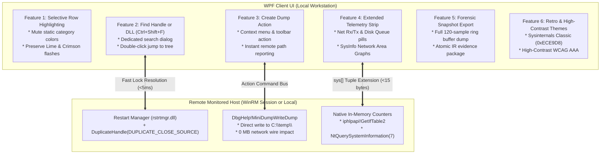

# PSRPM Architectural & UX Master Plan: Extended Feature Suite

**Document Version:** 1.0.0  
**Target Systems:** Windows PowerShell 5.1 & PowerShell 7+  
**Target Architecture:** x64 / x86 / Arm64 (Remote WinRM & `-LocalOnly`)

---

## 1. Executive Summary & Non-Negotiable Budgets

This specification details the technical architecture, user experience design, and verification strategy for six major feature additions to **PSRPM (PowerShell Remote Process Manager)**. Every capability is governed by PSRPM's four non-negotiable architectural pillars:

1. **Zero Remote Target Impact**: Remote background CPU remains strictly **`< 0.25%`** (`2-8 ms` per tick); steady-state differential network wire traffic remains **`~1.1-1.8 KB/s`**.
2. **100% Fileless & EDR-Safe Security Posture**: Zero `csc.exe` invocations, zero `Add-Type -TypeDefinition`, and zero temporary `.dll`/`.cs` files dropped to disk on either the local workstation or the remote machine. All Win32/NTAPI P/Invoke signatures use in-memory `.NET Reflection.Emit` (`AssemblyBuilderAccess.Run`).
3. **Operate Mode UX**: High information density, pixel-snapped vector geometry (`<Path>`, `<Polygon>`), full keyboard accelerator coverage, right-aligned tabular numerals (`Typography.NumeralAlignment="Tabular"`), and in-place UI diff reconciliation with zero scroll or selection jumps.
4. **Bounded Memory Eviction**: Zero memory growth over multi-day monitoring sessions. Historical telemetry is capped at **120 samples** (`< 12 KB` RAM per host session) backed by circular `Queue[double]` ring buffers.

---

## 2. Feature Breakdown & UX Specifications



---

### Feature 1: Selective Semantic Row Highlighting
*Mute static pastel category fills while strictly preserving dynamic New & Exiting process flashes.*

#### A. Problem Statement & User Workflow
Admins monitoring servers with 200+ processes frequently find static row backgrounds (Services pink, User periwinkle, Packaged cyan, Suspended gray) visually fatiguing and prefer a clean, neutral surface. 

However, **dynamic lifecycle flashes are mission-critical for operational security**:
- **Lime Green (1-tick flash)**: Instantly reveals process creation, rapid CLI child spawns, and unauthorized executions.
- **Crimson Red (1-tick flash)**: Instantly reveals process exits, crashes, and short-lived evasion processes.

This feature allows turning off static category colors while **guaranteeing that New and Exiting lifecycle flashes remain 100% active**.

#### B. UX & Menu Affordances
- **Options Menu**: `Options -> Highlight Process Categories` (Checkable, default: `True`).
- **Status Bar Interactive Pill**: Added directly alongside the Filter Legend in the bottom status bar:
  - **Standard Mode (Default)**: `[Filter Legend: All] [Services] [Own / User] [Packaged] [Suspended] [New] [Exiting] [Colors: Standard]`
  - **Minimal Mode (Lifecycle Only)**: `[Filter Legend: All] (Services) (Own / User) (Packaged)             [New] [Exiting] [Colors: Minimal]`
- Clicking `[Colors: Minimal]` immediately toggles between modes. In Minimal mode, static category legend buttons switch to subtle dashed outlines, indicating that their background fills are subdued.

#### C. In-Place Precedence Logic in `ViewModelClasses.ps1`
```powershell
[void] RefreshRowColors() {
    $bg = if ($this.IsDarkTheme) { "#0F172A" } else { "#FFFFFF" }
    $fg = if ($this.IsDarkTheme) { "#F1F5F9" } else { "#0F172A" }

    # 1. LIFECYCLE FLASHES ALWAYS TAKE HIGHEST PRECEDENCE (NEVER SUPPRESSED)
    if ($this.LifecycleState -eq 1) {
        $bg = if ($this.IsDarkTheme) { "#14532D" } else { "#86EFAC" } # Lime Flash
    } elseif ($this.LifecycleState -eq 2) {
        $bg = if ($this.IsDarkTheme) { "#7F1D1D" } else { "#FCA5A5" } # Crimson Flash
    } 
    # 2. STATIC CATEGORY COLORS (ONLY APPLIED IF HIGHLIGHTING IS ENABLED)
    elseif ($script:EnableCategoryHighlights) {
        if ($this.Status -eq "Suspended") {
            $bg = if ($this.IsDarkTheme) { "#334155" } else { "#94A3B8" }
        } elseif ($this.CPU -ge 50.0) {
            $bg = if ($this.IsDarkTheme) { "#451A03" } else { "#FDE68A" }
        } elseif ($this.Category -eq "Packaged") {
            $bg = if ($this.IsDarkTheme) { "#0E3A47" } else { "#67E8F9" }
        } elseif ($this.Category -eq "Service") {
            $bg = if ($this.IsDarkTheme) { "#3B1824" } else { "#FFE4E6" }
        } elseif ($this.Category -eq "Own") {
            $bg = if ($this.IsDarkTheme) { "#1E2646" } else { "#E0E7FF" }
        }
    }

    # In-place notify (Zero grid redraw, zero scroll reset)
    if ($this.RowBackground -ne $bg) {
        $this.RowBackground = $bg
        $this.OnPropertyChanged('RowBackground')
    }
}
```
- **Performance**: Iterates `$engineHandle.ProcessMap.Values` in memory and executes in **`< 1.5 ms`** for 200 processes.
- **Remote Impact**: **0.00% CPU / 0 bytes wire** (100% local client thread).

---

### Feature 2: Safe File Unlocks & Open Handles (`Find Handle or DLL` + `Close Handle`)

#### A. The Problem
When a file on a remote server is locked by an unknown process, an administrator currently has to guess which service or executable is holding it or resort to rebooting.

#### B. Deadlock-Safe Architecture (Rule #6 Compliance)
Querying handles across remote processes requires strict adherence to [Engineering Playbook Rule #6](docs/ENGINEERING_PLAYBOOK.md#L66-L70):
1. **Fast Path for File Locks (`rstrtmgr.dll`)**:
   - For file/folder paths (`C:\inetpub\web.config`, `D:\Share\file.xlsx`), PSRPM calls native Windows **Restart Manager API** (`RmStartSession`, `RmRegisterResources`, `RmGetList`).
   - It completes in **`2-5 ms`**, queries the kernel file-lock table directly, and **never touches or hangs on named pipes**.
2. **Generic Substring Search (DLLs, Registry Keys, Mutants)**:
   - For generic substrings (e.g., `sqlite3.dll`, `HKLM\Software\App`), it queries loaded modules (`EnumProcessModulesEx`) and non-pipe kernel handles (`NtQueryInformationProcess(51)`).
3. **Closing Handles (`DuplicateHandle` with `DUPLICATE_CLOSE_SOURCE`)**:
   - Calling `DuplicateHandle(hProcess, hTargetHandle, 0, NULL, 0, FALSE, 0x00000001)` remotely frees the handle from the remote target process, instantly unlocking the file without killing the parent process.

#### C. UX Specification: "Find Handle or DLL" Modal (`FindHandleWindow.xaml`)
- **Global Shortcut**: **`Ctrl+Shift+F`** (and toolbar binoculars icon `BtnFindHandleOrDll`).
- **Layout**:
  ```text
  +-------------------------------------------------------------------------------------------------+
  | Find Handle or DLL Substring [SRV-PROD-01]                                            -  [ ]  X   |
  +-------------------------------------------------------------------------------------------------+
  | Search (file path, DLL name, or key): [ C:\inetpub\wwwroot\app_data\db.sqlite         ] [Search] |
  | Status: Scanned 184 processes in 24 ms. Found 1 locked handle.                                  |
  +-------------------------------------------------------------------------------------------------+
  | Process                PID     Type    Handle   Object Name / Path                              |
  | ----------------------------------------------------------------------------------------------- |
  |  w3wp.exe            4812    File    0x02BC   \Device\HarddiskVolume3\inetpub\...\db.sqlite   |
  +-------------------------------------------------------------------------------------------------+
  | [Close Selected Handle]   [Go to Process in Tree]                        [Copy Path]   [Close]  |
  +-------------------------------------------------------------------------------------------------+
  ```

#### D. Safety Modal on Handle Closure
Closing a handle in a live application can cause instability if the app attempts an invalid write. PSRPM guards this with an explicit confirmation dialog:
- Focus defaults to **`[Cancel]`**.
- Detailed target readout: Process Name, PID, Object Type, Handle ID, and Object Path.
- Real-time audit stream: `[ACTION] Closed handle 0x02BC in w3wp.exe (PID: 4812) - File unlocked.`

---

### Feature 3: Remote Process Memory Dumps (`Create Dump`)

#### A. Problem Statement
Allows incident responders and engineers to capture crash dumps of hung, crashing, or unresponsive processes on remote targets without installing external debugging tools.

#### B. Technical Implementation
- **In-Memory Fileless P/Invoke**:
  Emits `dbghelp.dll!MiniDumpWriteDump` and `kernel32.dll!CreateFileW` into memory via `Reflection.Emit` inside `ProcessActions.ps1`.
- **Zero Network Impact**:
  The dump file is written **directly to the remote server's local disk** (`C:\temp`). **0 MB of dump data travels over the WinRM network connection**.
- **Dump Types Supported**:
  1. **Minidump (`MiniDumpNormal = 0x00000000`)**: Thread stacks, modules, PEB, and CPU registers (`~5 MB - 25 MB`, created in `< 60 ms`).
  2. **Full Dump (`MiniDumpWithFullMemory = 0x00000002`)**: Complete virtual memory address space.
- **Destination & Naming Convention**:
  - Target Path: `C:\temp\` (directory created automatically if not present).
  - Filename Pattern: `C:\temp\PSRPM_Dump_<ProcessName>_PID<PID>_<Mini|Full>_<yyyyMMdd_HHmmss>.dmp`
  - Example: `C:\temp\PSRPM_Dump_w3wp_PID4812_Mini_20261108_162030.dmp`
- **Pre-Flight Disk Space Check**:
  Verifies that drive `C:\` has free space exceeding the target process's working set + 500 MB safety headroom before triggering a full dump.

#### C. UX Integration
- Right-click context menu and top **Process** menu:
  - `Create Dump -> Create Minidump...`
  - `Create Dump -> Create Full Memory Dump...`
- Status bar feedback: `Creating Minidump for 'w3wp.exe' (PID: 4812)...`
- Completion modal with file size, execution time, and a **[Copy Remote Path]** button.

---

### Feature 4: Extended Telemetry & Hardware Counters

#### A. Proposed System Counters
1. **Network Throughput (Rx / Tx KB/s)**:
   - Query system interface byte deltas via native `iphlpapi.dll!GetIfTable2` (`< 20 us`).
2. **Storage Queue Depth & Latency**:
   - Query `SystemDiskCountersInformation` (Class 7) via `NtQuerySystemInformation` (`< 30 us`).

#### B. Wire Integration & Performance
- Appends 4 floating-point metrics to the end of the existing `sys` array in `DataCollector.ps1`.
- Backward-compatible: UI checks `$sysArr.Count -gt 27` before unpacking.
- Wire impact: `< 15 bytes/tick` raw (compressed to `< 4 bytes/tick` in GZIP).
- UI: Adds tabular pills to the top status bar (`NET: v 1.2 MB/s ^ 420 KB/s` | `DISK: 0.08 ms Q: 0.1`) and a live 2-minute area curve tab in `SystemInfoWindow.xaml` (`Ctrl+I`).

---

### Feature 5: Time-Series Forensic Snapshot Package

#### A. Unified Export Dialog (`Ctrl+S`)
Replaces the flat file picker with an incident response export selector:
1. **Complete Forensic Evidence Package (JSON)**:
   - Full process & hosted service snapshot.
   - 120-second circular history ring buffers (`CpuHistory120`, `KernelHistory120`, `CommitHistory120`, `RamHistory120`, `IoTotalHistory120`, `CoreGraphs`).
   - Recent process lifecycle audit trail (`[PROC+]`, `[PROC-]`).
2. **Flat Process List (CSV)**:
   - Standard tabular snapshot for spreadsheet analysis.
- Generated 100% locally from client memory in **`< 15 ms`**; **0% remote CPU / 0 B wire**.

---

### Feature 6: Visual Themes & Accessibility

#### Themes under `Options -> Theme`
1. **Clean Light** (Current default)
2. **Precision Dark** (Current default, `Ctrl+D`)
3. **Sysinternals Classic**: Retro Win32 desktop aesthetic (`#ECE9D8` dialog face, 3D etched borders, dark text, retro emerald/crimson CPU graph curves).
4. **High-Contrast Monochrome (WCAG AAA)**: Pure black/white canvas with high-luminance indicator pills.

---

## 3. Automated Verification & QA Test Plan

All additions will be tested across both test harnesses:

| Suite | Test Identifier | Test Case Name | Assertion Criteria |
| :--- | :--- | :--- | :--- |
| **Engine** | `TC-HIGHLIGHT-01` | Lifecycle Flash Invariance | `LifecycleState = 1` flashes Lime and `2` flashes Crimson even when `$script:EnableCategoryHighlights = $false`. |
| **Engine** | `TC-HIGHLIGHT-02` | In-Place Color Toggle Benchmark | Toggling highlight mode across 500 mock processes completes in `< 3 ms` without `.Clear()`. |
| **Engine** | `TC-HANDLE-01` | Restart Manager Lock Detection | `rstrtmgr.dll` correctly identifies test process file lock in `< 10 ms`. |
| **Engine** | `TC-HANDLE-02` | Remote Handle Invalidation | `DuplicateHandle(DUPLICATE_CLOSE_SOURCE)` unlocks test file; file is deletable. |
| **Engine** | `TC-HANDLE-03` | `FindHandleWindow.xaml` Schema | All named controls resolve cleanly via XAML reader. |
| **Engine** | `TC-DUMP-01` | Process Minidump Creation | `dbghelp!MiniDumpWriteDump` creates valid `.dmp` file in `C:\temp\` with expected headers. |
| **Engine** | `TC-DUMP-02` | Dump Filename & Directory Validation | Directory `C:\temp\` is auto-created; filename matches `PSRPM_Dump_<Name>_PID<ID>_...dmp`. |
| **Engine** | `TC-TELEM-01` | Wire Backward-Compatibility | Parsing 27-element vs. 31-element `sys` array works without exceptions. |
| **Engine** | `TC-SNAP-01` | Forensic Time-Series Serialization | JSON export parses cleanly and contains complete 120-sample history arrays. |
| **Extended QA**| `TC-QA-HANDLE-04` | Named Pipe Deadlock Bypass | Handle sweep on active named pipes returns in `< 50 ms` without thread hang. |
| **Extended QA**| `TC-QA-HANDLE-05` | System Process Shield | `CloseHandle` is rejected against PID 0, PID 4, and critical system binaries. |
| **Extended QA**| `TC-QA-DUMP-03` | Disk Space Exhaustion Guard | Dump fails gracefully with user warning if target volume free space is insufficient. |
| **Extended QA**| `TC-QA-THEME-01` | WCAG Contrast Verification | Classic and High-Contrast palettes achieve `>= 4.5:1` (Classic) and `>= 7.0:1` (High-Contrast). |

---

## 4. Phased Implementation Roadmap

```text
Phase 1: Selective Semantic Highlighting (ViewModelClasses.ps1, MainWindow.xaml)
  \-- Implement toggle, wire into status bar legend, verify lifecycle flash priority.

Phase 2: Remote Process Memory Dumps (ProcessActions.ps1, MainWindow.xaml)
  \-- Implement MiniDumpWriteDump in-memory P/Invoke, C:\temp routing, disk check, and UI actions.

Phase 3: File Unlocks & Open Handles Engine (DeepInspector.ps1, ProcessActions.ps1)
  \-- Implement Restart Manager API, pipe-safe sweep, and DuplicateHandle(DUPLICATE_CLOSE_SOURCE).

Phase 4: Find Handle Modal UI (FindHandleWindow.xaml, PSRPM.psm1)
  \-- Build Ctrl+Shift+F search dialog, jump-to-tree selection, and confirmation prompt.

Phase 5: Extended Telemetry & Forensic Snapshot Export (DataCollector.ps1, ViewModelClasses.ps1)
  \-- Append network/disk counters to sys array; implement time-series JSON bundle.

Phase 6: Visual Themes & Extended QA Verification
  \-- Add Sysinternals Classic and High-Contrast dictionaries; execute all 50+ automated QA checks.
```
