# PSRPM Ultra-HD (2x Scaling) Screenshots - Clean Light Mode

This gallery contains ultra-high-resolution marketing and documentation screenshots for **PSRPM (PowerShell Remote Process Manager)** in **Clean Light Mode** (Sysinternals Refined).

- **Render Scale**: `192 DPI` (Double scaling / 2x Retina) for razor-sharp vector lines, text, and icons.
- **Aspect & Width**: Expanded 1520px wide layout showing full process paths, users, descriptions, and companies without horizontal clipping.
- **Target Context**: Pure enterprise sample server (`SRV-PROD-01.contoso.corp`, `CONTOSO\svc-monitor`) with zero local workstation or personal user info.

---

## Screenshot Gallery

### 1. Main Window - Sysinternals Refined Light Mode (Hero Shot)
**File**: [`01_process_tree_light.png`](01_process_tree_light.png) (3040 x 1680 @ 2x DPI)
- Full hierarchical Tree-Grid with pixel-snapped vector guide connectors
- Multi-host tabs (`SRV-PROD-01 [WINRM-SSL]`, `SRV-DB-02 [WINRM-SSL]`, `SRV-APP-03 [WINRM]`)
- Populated toolbar sparklines (CPU with kernel time line, Commit charge, I/O, Network)
- Semantic pastel category colors (Services in light cyan, User apps in periwinkle, Packaged in lavender)
- Process Explorer column metric tints (CPU green, Private Bytes yellow, Working Set orange)

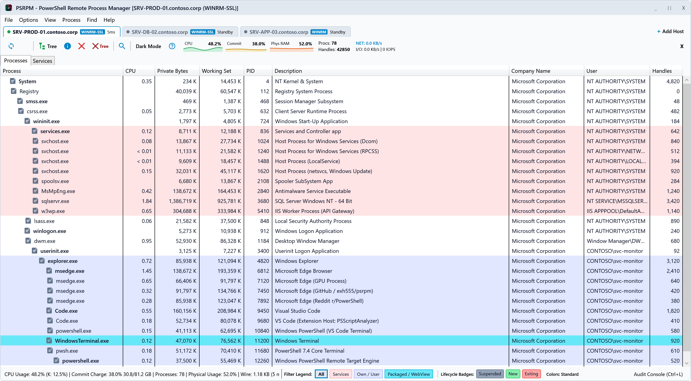

---

### 2. Ancestor-Preserving Search Filter
**File**: [`02_ancestor_search_filter.png`](02_ancestor_search_filter.png) (3040 x 1680 @ 2x DPI)
- Instant search filter preserving the entire parent-child process tree lineage
- Matching `powershell` processes highlighted at 100% opacity; ancestor nodes (`explorer.exe`, `userinit.exe`, `winlogon.exe`, `System`) remain visible with dimmed opacity (`0.62`)
- Sysadmins never lose context of which process or parent spawned the target

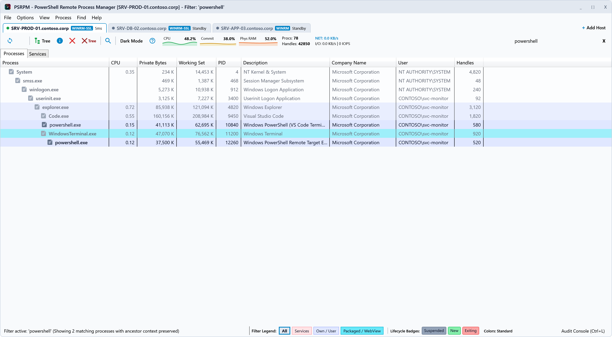

---

### 3. System Information Dashboard - Summary & Hardware
**File**: [`03_system_information_dashboard.png`](03_system_information_dashboard.png) (1840 x 1400 @ 2x DPI)
- Hardware metadata: `Dell PowerEdge R750 Enterprise Cloud Node` (16 Cores, 32 Threads, 64 GB RAM)
- 240-sample real-time CPU chart with kernel time red overlay and green grid
- Memory commit charge gauge, physical memory meters, and I/O delta charts
- Kernel performance counters: Context switches/s, Interrupts/s, System calls/s, DPCs/s, Page faults/s

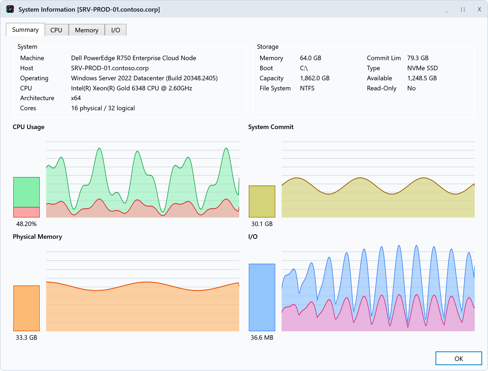

---

### 4. System Information - CPU & Kernel Telemetry
**File**: [`04_system_information_cpu.png`](04_system_information_cpu.png) (1840 x 1400 @ 2x DPI)
- Dedicated CPU telemetry dashboard with aggregate and per-core processor charts
- Kernel time vs. user time breakdown
- Real-time interrupt and context switch rate gauges

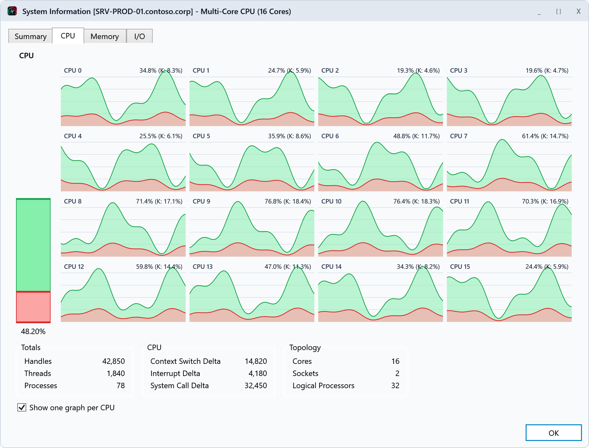

---

### 5. Process Properties Inspector - Image & Security
**File**: [`05_process_properties_image.png`](05_process_properties_image.png) (1720 x 1360 @ 2x DPI)
- Complete process metadata extracted from remote PEB and token
- Executable path, command line, working directory, parent process link, user SID, elevation level
- Verified exploit mitigations: DEP (Permanent), ASLR (High Entropy 64-bit), CFG (Control Flow Guard)

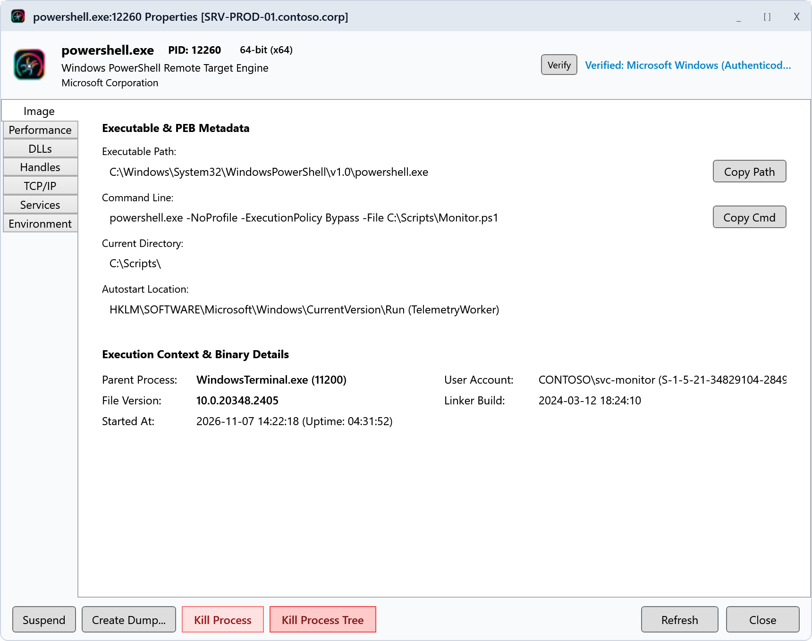

---

### 6. Process Properties Inspector - Performance & Process Tree
**File**: [`06_process_properties_performance.png`](06_process_properties_performance.png) (1720 x 1360 @ 2x DPI)
- Real-time CPU usage, total processor time, kernel/user time split, and cycle counts
- Handles, threads, working set memory, and private bytes meters
- Interactive focused parent-child process tree

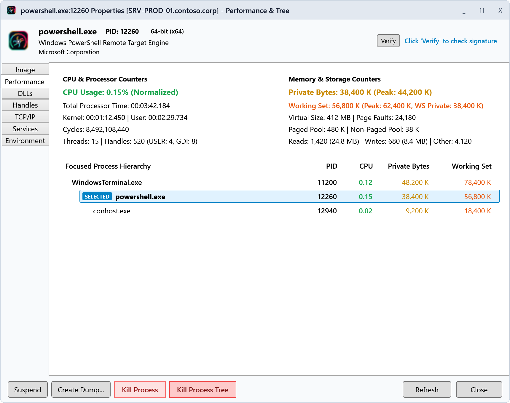

---

### 7. Process Properties Inspector - Loaded DLLs & Modules
**File**: [`07_process_properties_modules.png`](07_process_properties_modules.png) (1720 x 1360 @ 2x DPI)
- Lazy-loaded on-demand module inspection (< 46 ms)
- 64-bit base addresses, binary sizes, verified digital signatures, versions, disk paths

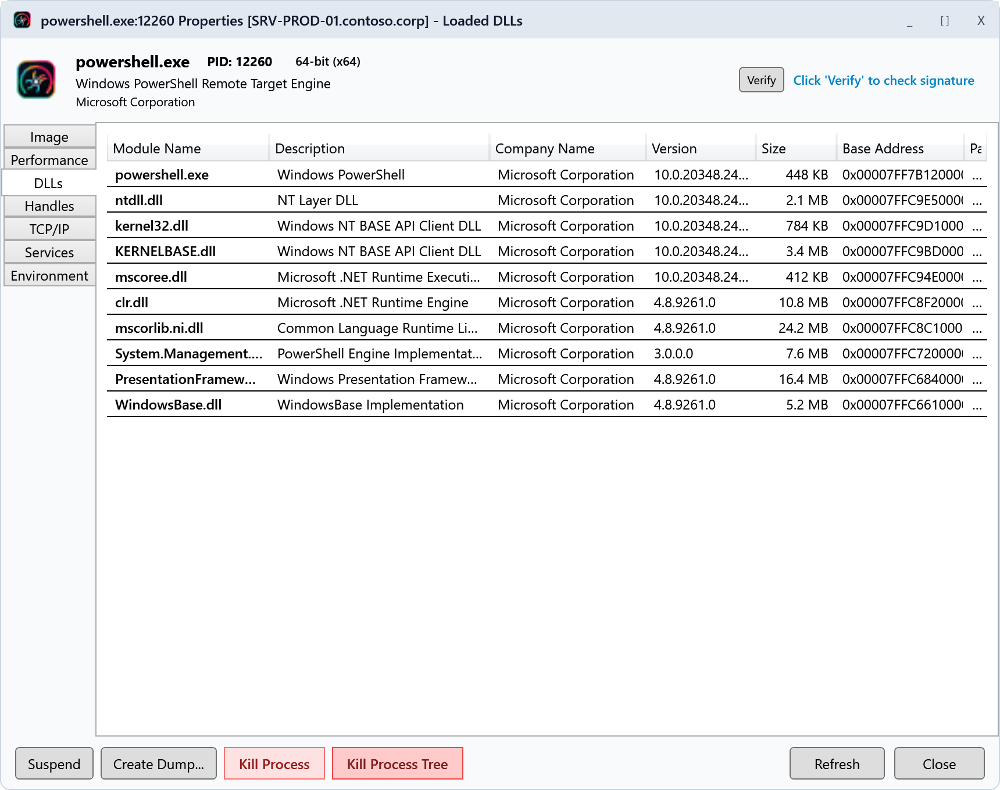

---

### 8. Live Audit & Network Telemetry Console (Ctrl+L)
**File**: [`08_live_telemetry_audit_console.png`](08_live_telemetry_audit_console.png) (3040 x 1760 @ 2x DPI)
- Expanded bottom telemetry drawer showing real-time WinRM differential packet logs
- Proof of ultra-low network impact: ~1.18 KB initial sync, ~0.28 KB delta ticks, < 5 ms RTT, 87% GZIP savings
- Real-time audit of process spawn/exit lifecycles and administrative actions

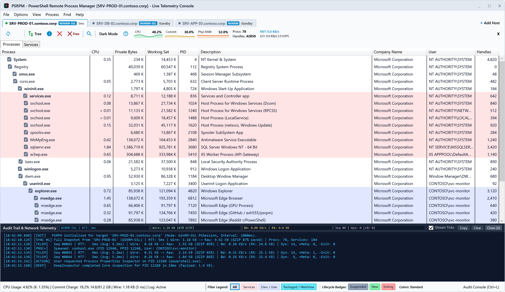

---

### 9. Connect to Target System Dialog (WinRM)
**File**: [`09_connect_remote_winrm.png`](09_connect_remote_winrm.png) (1040 x 800 @ 2x DPI)
- Enterprise remote connection dialog over WinRM HTTPS (Port 5986)
- Saved credentials profile and multi-session host tab selection

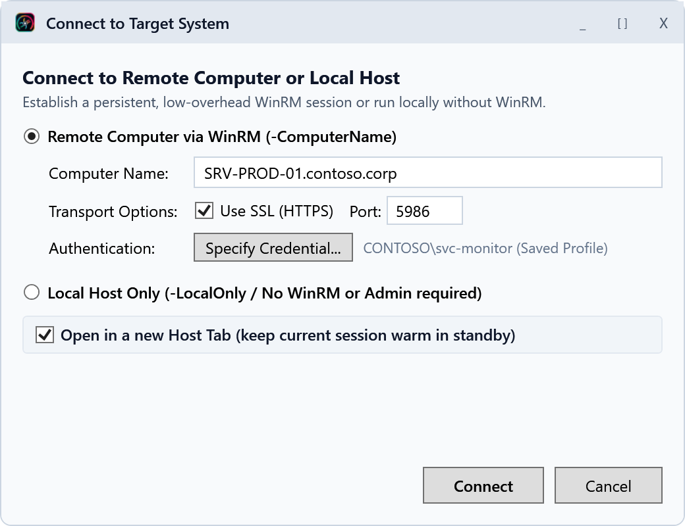

### 10. Services Manager Tab & Action Toolbar
**File**: [`10_services_manager_light.png`](10_services_manager_light.png) (3040 x 1680 @ 2x DPI)
- Full services catalog with live status badges, startup types, log on accounts, and dependencies column
- Dedicated action toolbar for instant Start, Stop, Restart, Properties, and Process navigation

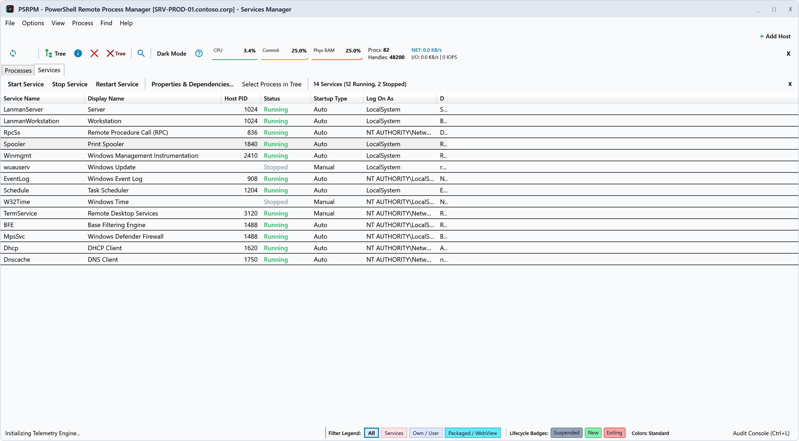

### 11. Service Details & Two-Way Dependencies Inspector
**File**: [`11_service_dependencies_inspector.png`](11_service_dependencies_inspector.png) (1240 x 1080 @ 2x DPI)
- Two-tab modal inspector with General details and interactive two-way Dependencies (Prerequisites and Dependents)
- Full Service Control actions (Start, Stop, Restart) directly within the modal inspector

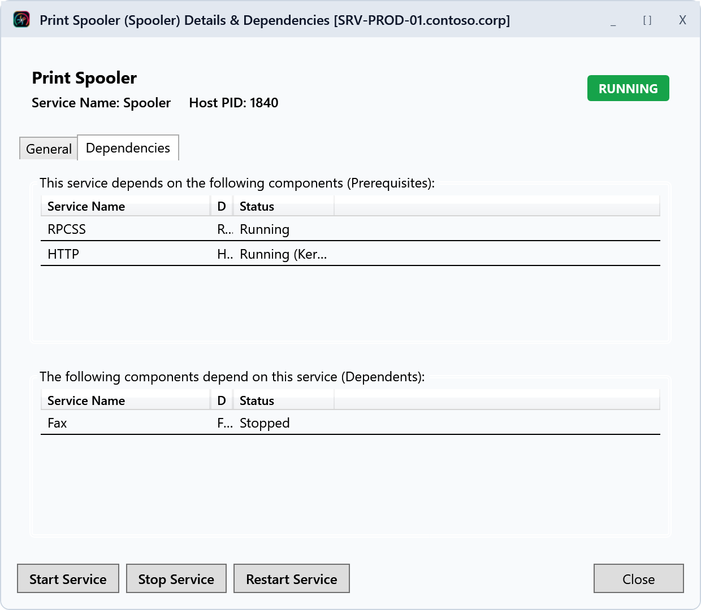

---

## How to Re-generate

To regenerate all screenshots at any time:
```powershell
powershell -NoProfile -ExecutionPolicy Bypass -File .\tools\Capture-Screenshots.ps1
```
